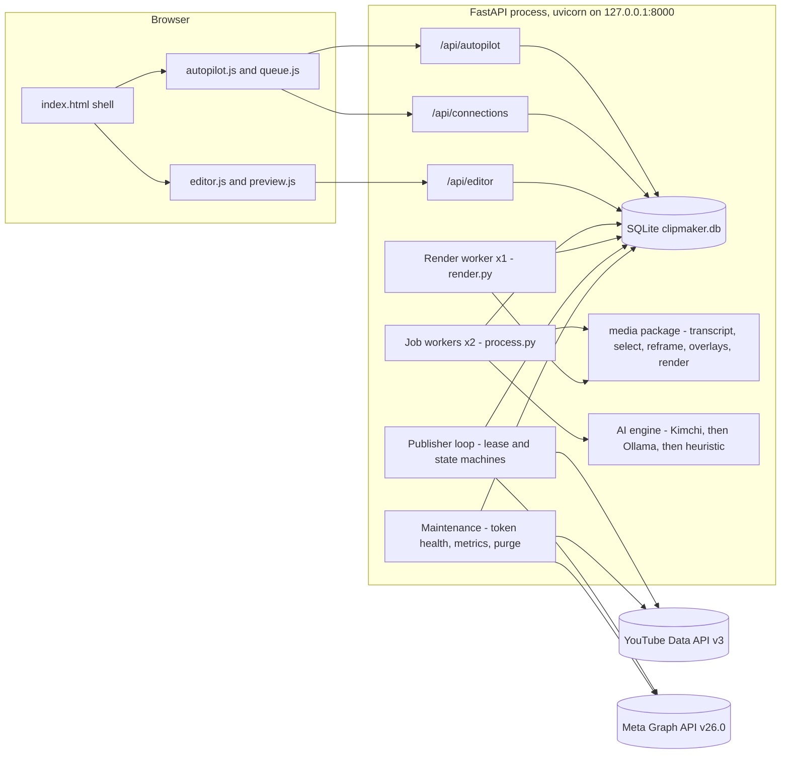
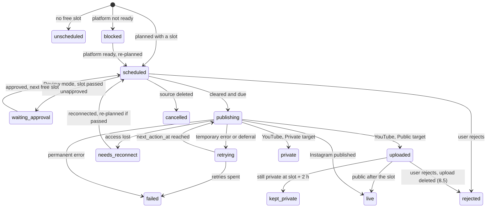

# Design: AI Autopilot — make, edit and auto-publish clips to YouTube and Instagram

Spec `i-want-to-build-ai` · feature · approved 7 Oct 2026 · amended 9 Oct 2026 while writing tasks (§4.6, §4.7, §8.6, §19, §20) and during tasks 4.3–5.3 (§4.2–§4.6) · implements `requirements.md` in this folder

## 1. Overview

Autopilot adds four parts to the existing app and reuses the rest:

1. **Source pipeline** (`autopilot/process.py`): turns a long video into clips, per-platform metadata and planned posts. It uses a multilingual word-level transcript, AI clip selection, face-tracked 9:16 reframing, and one declarative edit description (EditSpec) per clip.
2. **Posting plan** (`autopilot/planner.py`): gives each post a slot within per-account gap and daily limits. A review queue lets the user approve, edit or reject posts.
3. **Publisher** (`autopilot/publisher.py`): one background loop that moves each post through a durable state machine and talks to YouTube and Instagram through official-API clients written against plain HTTPS.
4. **Clip editor** (`static/js/editor.js`, `autopilot/editor_api.py`): edits an EditSpec over a low-resolution preview and renders a new clip version in the background.

All new state lives in the existing SQLite database, owned per user, behind three new routers. The unfinished `/api/pro` modules are deleted.

### Key decisions

| # | Decision | Why | Requirements |
|---|---|---|---|
| KD1 | Talk to both platforms with small HTTPS clients of our own (`httpx`); keep `google-auth` only for Google credentials | At-most-once publishing needs direct control of YouTube's resumable session URI and Instagram's container ID. One HTTP stack is also one thing to fake in tests | 8, 9, 10.1, N7.1 |
| KD2 | Instagram through "Instagram API with Facebook Login", signed in with Facebook Login for Business | It is the only documented route that uploads a local file (resumable upload). The Instagram Login route fetches the video from a public URL, which a laptop app does not have. Cost: the Instagram professional account must be linked to a Facebook Page | 9, 11.4 |
| KD3 | YouTube native scheduling: upload in the 24 h before the slot as private with `status.publishAt` | The post goes live on time even when the laptop is asleep at the slot. Needs the `youtube` scope so the app can update, unschedule and delete its own uploads | 6.9, 8.2–8.6 |
| KD4 | Autopilot transcribes with multilingual faster-whisper (`small`, int8) and word timestamps; the manual flow keeps captions-first | Real word timing (3.4), language detection (2.6) and punctuation for sentence boundaries (2.2), while the manual flow keeps today's speed | 2, 3, 1.8 |
| KD5 | One durable state machine per post in SQLite, advanced by a single publisher loop that holds a database lease | Survives restarts, never runs twice even if two server processes share the database, and keeps one upload per account in flight | 10, N2 |
| KD6 | Face tracking with OpenCV's YuNet detector and a hold-still tracker; the crop moves through ffmpeg `sendcmd` | `crop` `x`/`y` are runtime-settable in the installed ffmpeg 8.1.2. Holding still until the face leaves a safe zone meets 3.2 without jitter | 3.2, 3.3 |
| KD7 | All burned text (captions and hook) is drawn by Pillow into one PNG sequence and overlaid as a single ffconcat input | Today's renderer adds one `overlay` filter per caption chunk; one input keeps the filter graph small and the render fast. The installed ffmpeg has no `drawtext` or `subtitles` filter | 3.4, 3.5, 3.7, N1.4 |
| KD8 | Complex scripts (Devanagari, Arabic, Bengali…) use Pillow's raqm layout, which loads FriBiDi at runtime; FriBiDi is not installed today (verified) | Setup installs it, readiness reports it, and posts whose captions need it are held while it is missing instead of going out with broken text | 3.5, 11.3 |
| KD9 | Every clip edit is a declarative EditSpec rendered by one renderer; versions are immutable | AI output, user edits and re-renders share one code path; a failed render never touches the version in use | 3, 7.7, 7.8 |
| KD10 | Media is served with in-app HTTP Range support | Starlette 0.38.6 (pinned by FastAPI 0.115.0) has no Range support in `FileResponse`; editor scrubbing and Safari playback need it | 7.2 |
| KD11 | New code lives in packages `autopilot/`, `platforms/`, `media/`; existing flat modules become thin adapters | Keeps `app.py` imports working while giving the new code clear boundaries | N6.1 |
| KD12 | New tables key ownership on `owner_id`: the signed-in user's id, or the literal `local` in single-user mode | Avoids `NULL` comparisons and gives every new endpoint one ownership check | N4 |
| KD13 | Frontend stays vanilla JS with no build step: hash-routed views loaded as ES modules from `static/js/` | Matches the current single-page app in `static/index.html` | 6.5, 7 |

## 2. Architecture



### 2.1 Process model

The app stays one uvicorn process (`start.sh` binds 127.0.0.1). Background work runs on daemon threads started in `app.py`:

| Thread | Count | Work | Notes |
|---|---|---|---|
| Job workers | `CLIPMAKER_WORKERS` (default 2) | Source processing, manual and Autopilot | Existing queue; sources start in submission order (1.2) |
| Render worker | 1 | Editor renders and editor proxies | Separate, so an edit never waits behind a 60-minute source (N1.4) |
| Publisher | 1 | Tick every 20 s; dispatches steps to one single-thread executor per account | Holds the `publisher_lease` row; a second process on the same database stays idle |
| Maintenance | 1 | Hourly tick: token health, daily metrics, activity purge, re-planning of blocked posts | Skips work that already ran within its interval |

### 2.2 Modules

New:

| Module | Responsibility |
|---|---|
| `autopilot/store.py` | Data access for the new tables, using `db._conn()` and `db._LOCK` |
| `autopilot/migrations.py` | Database backup and versioned migrations (`PRAGMA user_version`) |
| `autopilot/owner.py` | `current_owner` dependency; per-owner preferences (time zone, pause, last profile) |
| `autopilot/profiles.py` | `ProfileSettings` model, defaults, CRUD |
| `autopilot/intake.py` | URL probe, length and rights checks, submission, restart re-queue |
| `autopilot/process.py` | Autopilot source pipeline (§4) |
| `autopilot/metadata.py` | Per-platform metadata generation, validators, transcript check, holds (§5) |
| `autopilot/planner.py` | Pure slot-assignment functions (§6) |
| `autopilot/publisher.py` | Publisher loop, lease, missed slots, pause, dispatch (§8) |
| `autopilot/readiness.py` | Readiness checklist (§9.4) |
| `autopilot/activity.py`, `autopilot/metrics.py`, `autopilot/maintenance.py` | Activity log, metric snapshots, hourly maintenance (§11) |
| `autopilot/api.py`, `autopilot/connections_api.py`, `autopilot/editor_api.py` | Routers for `/api/autopilot`, `/api/connections`, `/api/editor` (§14) |
| `platforms/http.py`, `platforms/errors.py`, `platforms/limits.py` | `httpx` client factory with token-redacting logging; error classification; text and file limits |
| `platforms/google_creds.py`, `platforms/youtube_api.py` | Google credentials for both run modes; YouTube resumable upload, videos list/update/delete, thumbnails, uploads lookup, statistics |
| `platforms/meta_auth.py`, `platforms/instagram_api.py` | Facebook Login for Business, token exchange, Page discovery, `debug_token`; publishing limit, containers, resumable upload, status, publish, media lookup, insights |
| `media/transcript.py`, `media/select.py` | Word-level transcript and sentences; AI clip selection with fallbacks |
| `media/editspec.py`, `media/keep.py` | EditSpec model and operations; keep spans and time mapping |
| `media/reframe.py`, `media/cover.py` | Face detection, shot cuts, crop track; cover-frame choice |
| `media/text.py`, `media/overlays.py` | Script detection, fonts, shaping, LTR/RTL layout; caption and hook frames, ffconcat list |
| `media/render.py`, `media/proxy.py`, `media/probe.py`, `media/ranged.py` | EditSpec renderer; editor proxies; `ffprobe`; Range-capable file responses |
| `static/js/{api,router,autopilot,queue,editor,preview}.js`, `static/css/autopilot.css` | Frontend views (§15) |

Changed: `app.py` (routers, threads, Origin check, umask, ranged clip endpoint, request persistence, schedule endpoints over posts), `db.py` (WAL, busy timeout), `pipeline.py` (builds one version-1 EditSpec per clip and renders it with `media/render.render_version` in the Fit layout; keeps its signature and result shape — task 5.6, §4.6), `highlights.py` (selection moves to `media/select.py`), `captions.py` and `thumbnail.py` (font resolver; `thumbnail.generate` gains an `at` time), `youtube_upload.py` and `youtube_oauth.py` (scope sets), `requirements.txt`, `setup.sh`, `start.sh`, `static/index.html`.

Removed: `api_pro.py`, `presets.py`, `batch.py`, `analytics.py`, `scheduler_advanced.py`, `editor.py`, `scheduler.py` (§13).

## 3. Data model

Conventions: times are UTC epoch seconds (`REAL`), as in today's tables. JSON columns end in `_json`. `owner_id` is a user id, or `local` in single-user mode (KD12). `jobs.user_id` keeps its current meaning (`NULL` in single-user mode), so a job's owner is `coalesce(user_id, 'local')`.

### 3.1 New columns on `jobs`

```sql
ALTER TABLE jobs ADD COLUMN autopilot INTEGER NOT NULL DEFAULT 0;
ALTER TABLE jobs ADD COLUMN profile_id TEXT;
ALTER TABLE jobs ADD COLUMN profile_snapshot_json TEXT;    -- settings used (14.3)
ALTER TABLE jobs ADD COLUMN request_json TEXT;             -- replayable request (1.5)
ALTER TABLE jobs ADD COLUMN attempts INTEGER NOT NULL DEFAULT 0;
ALTER TABLE jobs ADD COLUMN stage TEXT;                    -- 1.3
ALTER TABLE jobs ADD COLUMN source_key TEXT;               -- 'yt:<video id>' or 'file:<sha256>' (13.4)
ALTER TABLE jobs ADD COLUMN source_channel_id TEXT;
ALTER TABLE jobs ADD COLUMN source_channel_title TEXT;
ALTER TABLE jobs ADD COLUMN source_duration REAL;          -- 1.6
ALTER TABLE jobs ADD COLUMN language TEXT;                 -- detected or forced (2.6, 2.7)
ALTER TABLE jobs ADD COLUMN rights_basis TEXT;             -- 'own_channel' | 'confirmed' (13.1, 13.2)
ALTER TABLE jobs ADD COLUMN rights_confirmed_at REAL;
ALTER TABLE jobs ADD COLUMN ai_calls INTEGER NOT NULL DEFAULT 0;   -- N8.1
ALTER TABLE jobs ADD COLUMN best_score INTEGER;            -- 1.7
ALTER TABLE jobs ADD COLUMN deleted_at REAL;               -- source deleted (1.9; task 9.6, schema version 4)
```

### 3.2 New tables

```sql
CREATE TABLE profiles(
  id TEXT PRIMARY KEY, owner_id TEXT NOT NULL, name TEXT NOT NULL,
  settings_json TEXT NOT NULL, is_default INTEGER NOT NULL DEFAULT 0,
  revision INTEGER NOT NULL DEFAULT 1, created_at REAL, updated_at REAL);
CREATE INDEX ix_profiles_owner ON profiles(owner_id);

CREATE TABLE clips(
  id TEXT PRIMARY KEY, owner_id TEXT NOT NULL, job_id TEXT NOT NULL, idx INTEGER NOT NULL,
  src_start REAL NOT NULL, src_end REAL NOT NULL,     -- source span of the current version
  score INTEGER, score_reason TEXT, method TEXT,      -- 2.3, 2.5
  sensitive_json TEXT,                                 -- {flag, categories, reason} (13.3)
  current_version_id TEXT, created_at REAL);
CREATE INDEX ix_clips_job ON clips(job_id);

CREATE TABLE clip_versions(
  id TEXT PRIMARY KEY, clip_id TEXT NOT NULL, version INTEGER NOT NULL,
  spec_json TEXT NOT NULL,                             -- EditSpec (§4.4)
  status TEXT NOT NULL,                                -- rendering | ready | failed
  error TEXT, files_json TEXT,                         -- {original, vertical, cover, thumb, crop_track}
  probe_json TEXT,                                     -- duration, bytes, width, height, fps, codecs, audio rate
  cover_json TEXT,                                     -- {t, face, chosen}: the cover the render chose (task 9.3)
  created_at REAL, finished_at REAL,
  UNIQUE(clip_id, version));

CREATE TABLE accounts(
  id TEXT PRIMARY KEY, owner_id TEXT NOT NULL,
  platform TEXT NOT NULL,                              -- youtube | instagram
  external_id TEXT, name TEXT, avatar TEXT,            -- channel id or Instagram user id
  page_id TEXT,                                        -- Instagram: linked Facebook Page
  scopes_json TEXT, token_expires_at REAL, data_access_expires_at REAL,
  status TEXT NOT NULL, status_reason TEXT,            -- ok | needs_reconnect
  made_for_kids INTEGER,                               -- YouTube audience; NULL = not confirmed (4.7)
  audit_declared INTEGER, oauth_production_declared INTEGER,   -- advisory items (11.1)
  quota_key TEXT,                                      -- 'yt:<OAuth client id>' or 'ig:<Instagram user id>'
  thumbnail_capability TEXT,                           -- unknown | ok | unavailable (8.9)
  connected_at REAL, last_publish_at REAL,
  UNIQUE(owner_id, platform));

CREATE TABLE posts(
  id TEXT PRIMARY KEY, owner_id TEXT NOT NULL,
  job_id TEXT, clip_id TEXT, version_id TEXT,
  platform TEXT NOT NULL, account_id TEXT,
  method TEXT NOT NULL,                     -- official | legacy (manual schedules, 15.4)
  status TEXT NOT NULL,                     -- §3.3
  approval TEXT NOT NULL,                   -- pending | approved | auto | rejected
  holds_json TEXT NOT NULL DEFAULT '[]',    -- [{code, message, at}] (§5.3)
  slot_at REAL, slot_basis TEXT,            -- 'defaults' | 'your last N posts' | 'user' (5.4)
  user_locked INTEGER NOT NULL DEFAULT 0,   -- 5.5
  target_visibility TEXT NOT NULL DEFAULT 'public',   -- YouTube: public | private
  meta_json TEXT NOT NULL,                  -- current platform fields
  ai_meta_json TEXT NOT NULL,               -- the AI's version, for "Reset to AI version" (6.7)
  disclosure_ai INTEGER NOT NULL DEFAULT 0, -- 4.8
  step TEXT, step_data_json TEXT,           -- publisher step and its durable data (§8)
  next_action_at REAL, retry_count INTEGER NOT NULL DEFAULT 0,
  last_error TEXT, last_error_class TEXT,
  remote_dirty INTEGER NOT NULL DEFAULT 0,  -- metadata edited after upload (8.4)
  paused_hold INTEGER NOT NULL DEFAULT 0,   -- YouTube schedule removed by pause (6.9)
  platform_post_id TEXT, url TEXT, scheduled_publish_at REAL, published_at REAL,
  created_at REAL, updated_at REAL);
CREATE INDEX ix_posts_due ON posts(status, next_action_at);
CREATE INDEX ix_posts_owner_slot ON posts(owner_id, slot_at);
CREATE INDEX ix_posts_account_slot ON posts(account_id, slot_at);

CREATE TABLE publish_attempts(
  id TEXT PRIMARY KEY, post_id TEXT NOT NULL, step TEXT NOT NULL,
  started_at REAL, finished_at REAL,
  outcome TEXT,                             -- ok | temporary | permanent | deferred | access | interrupted
  http_status INTEGER, platform_code TEXT, request_id TEXT, message TEXT);
CREATE INDEX ix_attempts_post ON publish_attempts(post_id);

CREATE TABLE post_metrics(
  post_id TEXT NOT NULL, fetched_at REAL NOT NULL, age_hours REAL,
  views INTEGER, likes INTEGER, comments INTEGER,
  PRIMARY KEY(post_id, fetched_at));

CREATE TABLE platform_usage(               -- 'yt-uploads:<client id>' and 'yt-units:<client id>' per Pacific day
  key TEXT NOT NULL, window_start REAL NOT NULL, count INTEGER NOT NULL,
  PRIMARY KEY(key, window_start));

CREATE TABLE activity(
  id INTEGER PRIMARY KEY AUTOINCREMENT, owner_id TEXT NOT NULL, at REAL NOT NULL,
  actor TEXT NOT NULL,                      -- ai | user | system
  kind TEXT NOT NULL, job_id TEXT, clip_id TEXT, post_id TEXT,
  summary TEXT NOT NULL, detail_json TEXT);
CREATE INDEX ix_activity_owner_at ON activity(owner_id, at);

CREATE TABLE music_clearance(               -- 3.9
  owner_id TEXT NOT NULL, track TEXT NOT NULL, cleared_at REAL NOT NULL,
  PRIMARY KEY(owner_id, track));

CREATE TABLE app_state(key TEXT PRIMARY KEY, value_json TEXT NOT NULL);
-- publisher_lease {holder, expires_at}; publisher_heartbeat {at}; maintenance_last {task: at}
```

- Per-owner preferences go in the existing `user_settings` table under `skey = 'autopilot_prefs'`: time zone, pause flag, last profile, Autopilot switch default. Single-user mode uses `user_id = 'local'`.
- Secrets stay where the codebase keeps them today. In single-user mode they are git-ignored files (`token.json`, `client_secret.json`, and the new `meta_app.json`, `meta_token.json`); in multi-user mode they are `user_settings` rows (`youtube`, and the new `instagram_official`). `accounts` holds no secrets.
- Version 1 of a clip keeps today's file names (`NN-slug.mp4`, `NN-slug-vertical.mp4`, `NN-slug-thumb.jpg`) so existing library entries keep working; later versions add `.vN` before the suffix.

### 3.3 Post lifecycle

| Status | Meaning |
|---|---|
| `scheduled` | Has a slot. Publishes when cleared (approval `approved`, or `auto` in Full auto with no holds) and the owner is not paused |
| `waiting_approval` | Review-mode post whose slot passed unapproved; slot released (6.3) |
| `unscheduled` | No free slot within the 14-day horizon, or the user removed the slot |
| `blocked` | Platform not ready (11.2) or the file breaks a format limit (10.8); reason in `last_error` |
| `publishing` | A publisher step is running or due (`step`, `next_action_at`) |
| `retrying` | Temporary failure or deferral; `next_action_at` holds the next try (10.2) |
| `uploaded` | YouTube: uploaded as private with a scheduled publish time, or with that time removed by a pause |
| `live` | Visible on the platform |
| `private` | YouTube post whose target is Private, uploaded |
| `kept_private` | YouTube kept a Public-target video private (8.7) |
| `failed` | Permanent error, or retries spent |
| `needs_reconnect` | Account access lost or disconnected (10.7, 11.7) |
| `rejected` | Rejected by the user |
| `cancelled` | Source deleted (1.9) |



*As built in task 9.6 (`autopilot/sources.py`, with `posts.cleanup_step` and `publisher._withdrawn_meanwhile`):*
- **One path:** `DELETE /api/jobs/{id}` (the library), `GET /api/autopilot/sources/{id}/delete-impact` and `DELETE /api/autopilot/sources/{id}` share it. The preview returns the counts (`unpublished`, `youtube_uploads`, `scheduled_uploads`, `published`) and a sentence for the confirmation. The sources route requires `?confirm=<unpublished>`. If the count changed since the preview, nothing is deleted and the 409 reply carries the new preview. On `/api/jobs/{id}`, `confirm` is optional, so today's requests and replies are unchanged. The library's delete button now shows the preview's sentence in its confirmation and sends the count.
- *Changed from the design:* the source isn't removed. *Schema version 4* adds `jobs.deleted_at`. A deleted source leaves the library, the status route, ownership checks and restart recovery, and its files are deleted as before. Its row and clip rows stay, so published posts keep their source, and 13.4 still recognises their clips if the same video is submitted again; a hard delete would have let them be posted twice.
- **What happens to each post:**
  - **Kept as history** (untouched, with their metrics): `live`, `private`, `kept_private`, an Instagram Reel that went out and waits only for its link, and a scheduled upload that's done.
  - **Left as they are:** rejected and cancelled posts, and failed posts with nothing on the platform.
  - **Cancelled:** everything else, scheduled uploads included, with the reason "Its source was deleted.". The lock and (for Autopilot posts) the slot are cleared; a scheduled upload keeps its time for the "Scheduled posts" list, where it shows as `error`.
- **Cleanup (`posts.cleanup_step`),** run by the publisher even while paused:
  - `yt_delete` for a known YouTube video. *Changed from task 9.2:* on a cancelled post, a video already public becomes `live`, so it shows in the history; a rejected one keeps 9.2's behaviour;
  - new `yt_abandon` for an upload session with no known video id. It asks YouTube how far the upload got, or looks the video up if the session expired. A finished upload goes to `yt_delete`; an unfinished session is dropped, since YouTube makes no video from it;
  - new `ig_abandon` for an Instagram post at `ig_publish`, whose publish may have gone through. A container reading PUBLISHED means the Reel is out, so the post goes to `ig_resolve` and ends `live`; otherwise nothing was published.
  - Rejecting (6.5) now uses the same rule. *Fixed:* a rejected post waiting for a reconnect kept its publishing step, so reconnecting resumed the upload, and the video could still go public.
- **A step running at the time (`publisher._withdrawn_meanwhile`):** `_commit` reads the post's status in its transaction. If the user rejected the post, or deleted its source, while the step ran, the step's result doesn't overwrite that. Content that went out is kept as published, and the activity log says so. Otherwise the post stays withdrawn, keeps the identifiers the step produced, and gets the cleanup step it now needs. A scheduled upload checks the status `_commit` stored for its claim, so it never starts once its source is deleted.
- **Processing:** a source deleted while queued is skipped by the worker (`_dispatch`) and by `process.run`. While processing, `process.run` checks between stages and clips, stops quietly, and removes the folder again in case a render recreated it. The planner refuses a deleted source inside its own transaction, so no post is planned after the deletion. An uploaded file still waiting outside the job folder is deleted too.

## 4. Source processing (Requirements 1, 2, 3, 13.1–13.2)

### 4.1 Intake (`autopilot/intake.py`)

- `POST /api/autopilot/sources/probe {urls}` takes up to 20 URLs (1.2). Each goes through `urlguard.validate`, then `yt-dlp --skip-download --print "%(id)s\t%(title)s\t%(channel)s\t%(channel_id)s\t%(duration)s"` (60 s timeout). Per URL it returns the title, channel, duration and `own_channel` (the channel id equals the connected YouTube account's `external_id`), or an error. Sources over 3 hours are refused with the limit stated (1.6).
- The UI then shows a rights confirmation naming each source's channel (13.1). It is skipped when every source is on the user's own channel (13.2).
- `POST /api/autopilot/sources {urls, profile_id, rights_confirmed}` repeats those checks server-side and refuses when a confirmation is needed and missing. It creates one `jobs` row per URL (`autopilot = 1`, profile snapshot, `request_json`, `source_key = 'yt:<id>'`, channel, duration, `rights_basis`) and enqueues them in order.
- `POST /api/autopilot/sources/file` (multipart) saves the file the way `/api/process-file` does, reads its duration with `ffprobe` (1.6), streams a SHA-256 for `source_key`, and requires `rights_confirmed`.
- Restart (1.5): `intake.requeue_interrupted()` replaces `db.reconcile_jobs()` at startup. Jobs left `queued` or `running` with `attempts < 2` are re-enqueued from `request_json` with `attempts + 1`; the rest (including any with no stored request) are marked failed with "Interrupted twice by a restart". Manual jobs get the same behaviour because their requests are now persisted too (`/api/process` and `/api/process-file` call `store.set_request`). yt-dlp skips an already completed download. `intake` never imports `app` (that would cycle): `app.bootstrap` injects the enqueuer with `intake.set_enqueuer`, and the enqueuer reloads a job's request from `request_json`, so an Autopilot job carries only its id on the queue.
- Progress (1.3): `jobs.stage` takes `downloading` (0–15%), `transcribing` (15–40%), `choosing` (40–45%), `metadata` and `rendering` per clip with "clip N of M" (45–95%), and `planning` (95–100%).

*As built in task 6.5 (`autopilot/process.py`, worker dispatch in `app._dispatch`):*
- **Order:** source, transcript, selection, then for each clip: metadata, EditSpec, render version 1. Planning comes last. The settings are the profile snapshot stored at submission (14.3); a test edits the profile after submitting and checks that nothing changes.
- **Every selected clip gets metadata and a render, including clips below the minimum score.** They appear in the library with their score and reason (2.3), and the user can add a post for one by hand. Only clips reaching the minimum are planned (5.1). With none reaching it, the source finishes `done` with no posts, and its message names the minimum and the best score (1.7). `best_score` is stored.
- **A failed render** marks that version `failed` and logs it. That clip gets no posts, because `create_posts_for_job` plans only clips whose current version is `ready`; the others carry on. If no clip renders, the source fails.
- **Holds:** the metadata step judges `unsupported_claims` and `avoid_words` across both platforms' text, so they are stored on the clip with `sensitive` and `text_shaping` and apply to both of its posts.
- **Music that isn't cleared for publishing** is left out of every clip, with an activity entry saying so, rather than failing each render (3.9).
- **An upload** moves from the staging area into the job folder as `source<ext>`, so deleting the source deletes it, and a restart finds it there.
- **Progress and outcome:** stage messages read "Rendering clip 2 of 3", and progress moves within a clip as it renders, written only when the % changes. When the source finishes, `stage` is cleared and `message` holds the outcome. `ai_calls` is recorded on success and on failure.
- **Autopilot off (1.8):** `process.run` refuses a source with `autopilot = 0`, `create_posts_for_job` plans nothing for one, and `_dispatch` sends such sources to the manual flow.

### 4.2 Transcript (`media/transcript.py`)

- Autopilot runs `WhisperModel(os.environ.get("CLIPMAKER_WHISPER_MODEL", "small"), device="cpu", compute_type="int8")` with `language=profile.language or None`, `word_timestamps=True`, `vad_filter=True`, `beam_size=1` and `condition_on_previous_text=False`. Transcription progress comes from each segment's end time over the duration.
- Output is cached as `transcript.json` in the job folder:

  ```json
  {"v": 1, "language": "hi", "language_probability": 0.97, "source": "whisper", "estimated": false,
   "words": [{"w": "नमस्ते", "s": 12.34, "e": 12.71, "p": 0.93}],
   "sentences": [{"i": 0, "s": 12.34, "e": 15.2, "w0": 0, "w1": 7, "text": "…"}],
   "segments": [{"s": 12.34, "e": 15.2, "text": "…"}],
   "model": "small", "requested_language": null, "media": {"name": "source.mp4", "bytes": 331555168}}
  ```

- Sentences end after a word ending in `. ! ? । ॥ ؟ 。 ！ ？`, or before a pause longer than 0.8 s. A sentence longer than 25 s is split at its longest internal pause, so selection units stay small.
- The manual flow keeps today's order (YouTube captions, then Whisper) but writes the same file. Words taken from captions get today's length-weighted timing and `"estimated": true`.
- A sentence's words are `words[w0:w1]` (`w1` is exclusive). `Mr.`, `Mrs.`, `Ms.`, `Dr.`, `Prof.`, `e.g.`, `i.e.` and `vs.` don't end a sentence. Languages Whisper writes without spaces (`zh`, `ja`, `th`, `lo`, `my`, `yue`) are joined without them.
- `segments` keeps the source's own lines (Whisper segments or caption cues). `transcribe.transcribe()` returns them, so the manual flow's captions and trimming see the same lines as before; `pipeline.parse_subtitles()` is unchanged.
- A saved transcript is reused only when `source` is `whisper` and `model`, `requested_language` and `media` (file name and size) all match; otherwise Whisper runs again.

### 4.3 Clip selection (`media/select.py`)

- One AI call per source when the numbered sentence list is under about 60,000 tokens (estimated as characters ÷ 3). Longer transcripts are split into at most 3 overlapping chunks, one call each, and the results merged by score.
- Prompt contract (system prompt: the existing `_VIRAL_SYS`). Input: one `[i] mm:ss–mm:ss text` line per sentence, the language, N and the length range. Output: `{"clips": [{"start": i, "end": j, "title": str, "score": 0-100, "reason": "≤ 12 words"}]}` with up to 2N candidates.
- Validation in code:
  - indices must be in range and ordered;
  - length is fitted to the profile range by appending following sentences (too short) or dropping trailing ones (too long); a candidate that cannot fit is dropped (2.2);
  - candidates overlapping by more than half of the shorter one keep only the higher score (2.4);
  - sort by score, keep the top N, and label `method = "ai:<model>"`.
- Fallbacks (2.5): the existing Ollama picker, then the heuristic, both moved to sentence units, with scores from `highlights.score_viral_batch`. Each clip keeps the label of the method that chose it. When the AI engine was tried and failed, fallback candidates are scored by the keyword heuristic directly, so the failing engine isn't called again and selection stays within its three-call share of N8.1.
- The `ai:` label names the model that actually answered (`llm.chat` falls back across models when one is out of credits).
- AI calls are counted per thread by `llm.count_calls()`: one per `llm.chat()` call (however many models it tried) and one per Ollama generate call; listing Ollama's models is not counted.
- The manual flow keeps each caption or Whisper line as one selection unit, so its clips stay on the source's own line boundaries. Two edge cases keep today's behaviour: a source shorter than the range still gives one clip (the minimum drops to the source's length), and a single line longer than the range can still be a clip (the maximum rises to that line's length). `pipeline.process` ranks by the scores selection already produced instead of scoring a second time.
- Clips start and end on sentence boundaries made of whole words, so "never mid-word" (2.2) holds by construction. Keep-span padding (0.1 s) never crosses into a neighbouring word; it is clamped to the midpoint of the gap.

### 4.4 EditSpec (`media/editspec.py`)

```json
{
  "v": 1,
  "in": 123.40, "out": 168.20,
  "cuts": [[130.12, 131.05]],
  "auto_trim": true,
  "layout": "fill",
  "crop": {"mode": "auto", "x": null},
  "captions": {"enabled": true, "style": "words", "edits": {"1043": "Kimchi"}},
  "hook": {"enabled": true, "text": "The part nobody saw", "duration": 2.5},
  "music": {"track": null, "volume": 0.25},
  "cover": {"t": 3.2}
}
```

- `in`, `out` and `cuts` are source seconds. `captions.edits` keys are word indices into `transcript.json`. `crop.x` (manual mode) is the crop centre as a fraction of the source width. `cover.t` is clip time after cuts and trimming; `null` means it is chosen when rendering.
- Validation: `0 ≤ in < out ≤ source duration`; cuts lie inside `[in, out]` and are merged; the resulting length is at least 3 s, counted after auto-trim when the transcript's words are known; hook text is at most 48 characters and can't be empty while the hook is on; volume is between 0 and 1; the music track must be cleared (3.9); a corrected caption word is one line of at most 60 characters (removing a word is a cut, not an empty edit); a manual crop needs `x`; the cover time must be inside the clip. Every problem is reported with its field, for the editor to show next to the control.
- The AI's initial spec takes `in`/`out` from selection, no cuts, `auto_trim`, layout, caption style, hook switch and music from the profile, hook text from metadata (§5), and the cover from §4.6. The hook is off when metadata produced no hook text.

### 4.5 Keep spans (`media/keep.py`)

Keep spans are `[in, out]` minus `cuts`, minus, when `auto_trim` is on, every gap longer than 0.5 s between kept words and every filler-only phrase, each kept span padded by 0.1 s. This is today's `editing.py` rule moved from segments to words:

- A phrase is a run of words bounded by pauses longer than 0.5 s. A phrase whose whole text is filler ("um", "uh huh", "you know"…) is cut; filler inside a phrase is kept, because cutting it would chop up speech. The filler list is English, so speech in other languages is never treated as filler.
- A word belongs to the span its middle falls in. Padding never goes past the window or a cut, and never more than half-way to the neighbouring word, so no part of a removed word comes back.
- If the window holds no usable speech, nothing is trimmed.

The module also returns the source-time → clip-time mapping used by captions, the crop track and the cover: a time inside a removed stretch maps to where the next kept span begins.

### 4.6 Rendering (`media/render.py`)

Rendering version N of clip `NN-slug`:

1. **Original-ratio clip:** concatenate the keep spans (today's `cut_clip_segments`). Pixels are made square and dimensions even (yuv420p needs both), interlaced sources are deinterlaced (`bwdif`), and audio is 48 kHz stereo. A source with no sound gets a silent track, so every vertical has the audio Reels expects and music can still be mixed.
2. **Crop track** (Fill layout, `media/reframe.py`):
   - Sample the original clip at 4 fps, 640 px wide, with `cv2.FaceDetectorYN` (YuNet model in `models/`). If the model file is missing, use the Haar cascade bundled with OpenCV.
   - A shot cut is where the HSV-histogram correlation between consecutive samples drops below 0.6.
   - Within a shot, detections are linked when IoU ≥ 0.3. The primary face is the longest-present track (ties go to the larger box).
   - The crop is the source height × 9/16 wide. It holds still while the primary face box stays inside its central 70%. When the face leaves, the crop eases to re-centre over 0.4 s, starting 0.2 s before the sample that saw it leave (the whole clip is known in advance). It jumps at shot cuts, half-way between the samples on either side of the cut, and is clamped to the frame. A shot with no face is centred. Manual mode uses a fixed `crop.x`.
   - Output: a `sendcmd` file (`<t> crop@reframe x <px>;` at holds and jumps, every 1/15 s during eases) plus the track as JSON for the editor preview. The renderer names its crop filter `crop@reframe` and runs ffmpeg in the folder holding the command file, so the filtergraph needs no path escaping (`reframe.filter_chain()`).
   - The clip renders in Fit (3.3) if no shot has a face, if the planned crop would keep the face inside it in fewer than 95% of the samples where it was found (3.2), or if no face detector is available. A source that is already 9:16 or narrower needs no crop.
3. **Text overlay stream** (`media/overlays.py`):
   - Caption chunks follow today's styles: words (at most 3 words and 1.2 s), phrases (one sentence, wrapped to 3 lines), karaoke (groups of 4 with the active word in `#FFD63D`). Caption edits are applied first.
   - The hook box sits in the upper third for `hook.duration`, never longer than the clip.
   - Captions never run across a sentence boundary. A caption appears when its first word starts and stays until the next caption starts, or 0.5 s after its last word ends, whichever comes first. A karaoke word stays highlighted until the next word in its group starts. A phrase too long for 3 lines is split into pieces that each fit.
   - Every change point of captions or hook starts a new interval. Each interval gets one 1080×1920 RGBA PNG drawn by `media/text.py` (identical frames share one file), listed in an `ffconcat` file with exact durations (the last file is repeated, as the concat demuxer requires).
   - Each image in the list carries `option framerate 1000`, so ffmpeg times the frames to the millisecond. Without it the concat demuxer rounds every change to 1/25 s (measured with ffmpeg 8.1.2). The option needs `-safe 0` on the concat input; `overlays.input_args()` supplies both.
   - The stream joins the graph as one input: `[1:v]setpts=PTS-STARTPTS[t];[v][t]overlay=0:0:eof_action=pass`.
4. **Vertical:**
   - Fill is `sendcmd`, then `crop`, then `scale=1080:1920`; Fit is today's blurred background. Music uses today's sidechain ducking (3.9).
   - Encoding: `libx264 -preset veryfast -crf 20 -maxrate 20M -bufsize 20M -x264-params vbv-init=0.5 -bf 0 -pix_fmt yuv420p`, frame rate clamped to 23–60 fps (30 when the source is outside that range), AAC 128 kb/s at 48 kHz stereo, `-movflags +faststart -use_editlist 0` (Reels require the moov atom first and no edit lists). Source metadata and chapters are dropped, so details such as a phone's GPS tag aren't published.
   - *Changed in task 5.5, both measured on ffmpeg 8.1.2:*
     - **Rate control:** the design's `-bufsize 40M` starts the buffer 90% full, and x264 may spend that on top of the 20 Mb/s cap. A detailed 3 s clip averaged 26.6 Mb/s, over Reels' 25 Mb/s limit. A 20 Mb buffer starting half full allows at most 20 + 10 / 3 = 23.3 Mb/s on the shortest (3 s) clip; a test renders noise to check it.
     - **No B-frames (`-bf 0`):** without an edit list, x264's B-frame delay started the video 80 ms after the audio. This costs about 3% in file size. AAC's 1024-sample start-up delay remains: the muxer holds the first frame 21 ms longer, and audio and video stay in step.
   - Music: speech goes through `asplit`, so one copy feeds the mix and the other the sidechain; `amix` uses `normalize=0` in place of today's halving and doubling (same levels).
5. **Cover** (`media/cover.py`):
   - Sample at 2 fps, skipping the first and last 0.5 s. The samples come from the original-ratio clip, inside the crop window for Fill (the whole frame for Fit). *Changed in task 5.4 from sampling the vertical:* the captions and hook burned into the vertical are sharp text, so they counted as focus. On a real clip the vertical-scored choice was the frame with the hook box, over identical frames without it, which means a blurred shot under the hook could win. The measured area is about 540 px wide.
   - Score each frame as focus plus 0.5 when a face is detected, and keep the best as `cover.t`. Focus is the frame's Laplacian variance (numpy) divided by the clip's 90th-percentile variance and capped at 1. A high percentile rather than the maximum stops one unusually detailed frame (on-screen text, a cut to a crowd) from pushing every other frame's focus toward 0. A face frame wins when it is at least half as sharp as the clip's sharpest tenth. Ties go to the higher raw variance, then the earlier frame.
   - A time set in the editor is used without scoring, kept at least 0.1 s before the end so the grab lands on a frame.
   - Write a 1080×1920 cover JPEG from the vertical (scaled to fill and centre-cropped), and the 16:9 YouTube thumbnail via `thumbnail.generate()` at that time with title words. The thumbnail comes from the original-ratio clip, which shares the vertical's timeline, as today's flow does; a 9:16 frame fitted to 16:9 would keep only its middle third.
   - The thumbnail cap is 2,000,000 bytes, so it fits whichever meaning of "2 MB" YouTube applies. A larger file is re-saved at JPEG quality 80, 70, 60, 50 and then 40. If it still doesn't fit, it is dropped and YouTube chooses the frame (8.9).
6. **Probe and publish the version:** `media/probe.py` fills `probe_json` and the version becomes `ready`. The job's `result_json` entry for the clip is updated to the new files, so the existing library UI keeps working.
   - `render_version()` itself writes files only; the caller (the Autopilot pipeline, the editor, the manual flow) stores the version row and `result_json`. It returns the layout used, keep spans, kept duration, fps, file names, cover time, crop summary, probe results and the validated spec.
   - File names: today's `NN-slug.mp4`, `NN-slug-vertical.mp4` and `NN-slug-thumb.jpg`, plus the new `NN-slug-cover.jpg` and `NN-slug-crop.json` (Fill only). Later versions add `.vN` before the suffix.
   - Every file is built in a hidden `.render-NN-slug-vN` folder inside the job folder and moved into place only after all steps succeed. A failed render therefore never replaces a good one, and the work folder is always removed. A file this render didn't produce, such as the crop track of a version that fell back to Fit, is deleted, so an earlier render's file can't pass for this one's.
   - The spec is validated first, against the source's duration and the transcript's words. Music needs the caller's `is_cleared(track)` to say yes; without that check, music is refused (3.9).

### 4.7 Text drawing (`media/text.py`)

- **Script detection:** each character is classified by Unicode block: Latin/Cyrillic/Greek, Devanagari, Bengali, Gurmukhi, Gujarati, Oriya, Tamil, Telugu, Kannada, Malayalam, Arabic, Hebrew, Thai, or Han/Kana/Hangul.
- **Font resolution per script** tries, in order:
  1. the macOS system fonts found on this machine (Arial Bold, Kohinoor and ITF Devanagari, Kohinoor Bangla, Gujarati and Telugu, Noto Sans Kannada and Oriya, Geeza Pro, Noto Nastaliq Urdu, …);
  2. Debian Noto paths (`/usr/share/fonts/truetype/noto/…`) for Docker;
  3. any `.ttf`, `.otf` or `.ttc` the user drops in `fonts/`.

  Coverage is read from each font's character map with fontTools, because Pillow cannot report a missing glyph. A run whose characters the chosen font does not cover moves to the next candidate. A character that no candidate covers is dropped and logged, so nothing renders as a missing-glyph box (3.5).
- **Mixed lines** (for example Hinglish) are split into same-script runs, each drawn and measured with its own font.
- **Complex scripts** (Indic, Arabic, Hebrew, Thai) use `ImageFont.Layout.RAQM`. When `PIL.features.check_feature("raqm")` or `check_feature("fribidi")` is false, posts whose clip text needs shaping get a `text_shaping` hold and readiness shows the fix (KD8).
- **RTL lines** (first strong character Arabic or Hebrew) place words right to left, karaoke order included.
- **Emoji** are stripped from burned text (today's rule) but kept in metadata.

## 5. AI metadata (Requirements 4, 13.3, N8.1)

### 5.1 Calls per clip

| Call | When | Output |
|---|---|---|
| Write | Always | YouTube `{title, description, tags, category_id}`; Instagram `{caption, hashtags}`; `hook`; `title_suggestions` (kept for the existing clip card) |
| Check | Always | `{supported, unsupported_claims[], sensitive, sensitive_categories[], reason}`, judged against the transcript by a separate reviewer prompt |
| Rewrite | Only when Check or a validator fails; at most once | Write's output plus `self_check {supported, notes}` |

- *Task 6.2:* the Rewrite is NOT followed by a second Check — that would be a 4th call and break the 3-per-clip budget. Instead the Rewrite returns `self_check`, and `unsupported_claims` is held only when the original Check reported claims AND the rewrite's own `self_check.supported` is false. So Write + Check + Rewrite is the hard ceiling per clip.

- With 1–3 selection calls per source, a source with N clips uses at most 3N + 3 calls (N8.1). A per-job counter wraps `llm.chat` (thread-local, like `llm.set_request_config`) and increments `jobs.ai_calls`.
- The Write prompt is the existing `_REACH_RULES` plus:
  - the language (name and code);
  - the brand tone and the words to avoid;
  - the platform limits;
  - the assignable YouTube categories: 1 Film & Animation, 2 Autos & Vehicles, 10 Music, 15 Pets & Animals, 17 Sports, 19 Travel & Events, 20 Gaming, 22 People & Blogs (default), 23 Comedy, 24 Entertainment, 25 News & Politics, 26 Howto & Style, 27 Education, 28 Science & Technology, 29 Nonprofits & Activism.
- The Check prompt lists claims the transcript does not support and flags the sensitive categories of 13.3.

### 5.2 Deterministic validators (`platforms/limits.py`)

- **YouTube:**
  - Remove `<` and `>` from every field.
  - Title: at most 100 characters, trimmed at a word boundary.
  - Description: at most 5,000 UTF-8 bytes, trimmed at a character boundary with the footer kept.
  - Tags: at most 500 characters in total, counting commas and the quotes around tags that contain spaces; lowest-ranked tags are dropped first.
  - Category: must be from the list above.
- **Instagram:** caption at most 2,200 characters, with at most 30 hashtags (extras dropped from the end) and 20 @-mentions.
- **Brand:**
  - Words to avoid are matched case-insensitively at Unicode word boundaries. A match triggers Rewrite with the words named; if one is still present, the post gets an `avoid_words` hold.
  - Always-include hashtags and the monetization kit's call-to-action and links (`monetize.apply_to_description`) are appended by code after generation, so they are always present. The limits are then applied again.
- **Hook:** 2–6 words, and not equal (case-folded) to the title or the first sentence; otherwise `highlights.make_hook()`.

### 5.3 Holds

| Code | Cause | Applies to | Requirement |
|---|---|---|---|
| `unsupported_claims` | Check failed and the Rewrite is still unsupported | that post | 4.6 |
| `avoid_words` | A word to avoid survives the Rewrite | that post | 4.5 |
| `heuristic_metadata` | No AI engine answered; heuristic text used | every post of the clip | 4.9 |
| `sensitive` | Check flagged sensitive content | every post of the clip | 13.3 |
| `text_shaping` | Clip text needs complex shaping and raqm or FriBiDi is missing | every post of the clip | 3.5 |

## 6. Posting plan (Requirements 5, 13.4, 14.4)

### 6.1 Creating posts

At the planning stage, for each clip whose score reaches the profile minimum (5.1), and for each platform in the profile:

- **Skip** the clip for an account when 13.4 applies: it overlaps by more than half of the shorter clip with a clip of the same `source_key` that is already `live`, `uploaded` or `private` on that account. Activity records "Skipped: already posted".
- **Create** a post with:
  - `meta_json = ai_meta_json` (the platform fields);
  - holds from §5.3;
  - approval `pending` (Review mode) or `auto` (Full auto with no holds);
  - target visibility and AI disclosure from the profile.
- **Block** the post if the platform is not ready (§9.4): status `blocked` with the reason. The maintenance tick re-plans blocked posts once readiness turns green.

The planner then assigns slots to all new posts of the source.

### 6.2 Slot assignment (`planner.assign`)

A pure function of: the posts to place, the occupied slots per account, the profile windows, the minimum gap, the daily maximum, the time zone, and now.

```text
candidates = for d in 0..13 (local days from today):
               for h in windows[platform][weekday(d)]:
                 t = to_utc(local date d at h:00)   # zoneinfo; nonexistent local times move +1 h, ambiguous ones use fold=0
                 keep t if t >= now + 30 min
sort posts by (score desc, clip idx asc)
for post in posts:
    acc = occupied[post.account]   # user-locked, uploaded and live posts inside the horizon
    pick the first t in candidates where
        count(acc on the local date of t) < daily_max and
        every s in acc has |t - s| >= min_gap
    if found: post.slot_at = t; post.slot_basis = windows.basis; acc.add(t)
    else:     post.status = 'unscheduled', reason "No free slot in the next 14 days"
```

Re-planning (5.5, 6.10, 10.5, 10.7, 14.4) calls the same function with only the posts that are unpublished, not user-locked and not in flight, after freeing their old slots.

*As built in task 6.3 (`autopilot/planner.py`):*
- **Which slots are taken** (`occupied_slots`): user-locked posts always; posts that are `scheduled`, `publishing`, `retrying`, `uploaded`, `live`, `private` or `kept_private` unless they are being re-planned and a re-plan may move them. *Wider than the pseudocode's comment ("user-locked, uploaded and live"):* already scheduled posts from earlier sources must count too, or planning a new source would ignore them and break the gap and daily maximum. A post's time is its `slot_at`, else `scheduled_publish_at`, else `published_at`, so a live post with no slot still counts.
- Slots are tracked per platform, since each owner has one account per platform.
- A nonexistent hour that lands on another window hour gives one candidate, not two.
- Ties in score go to the lower clip number, then the post id, so the result is deterministic.
- `local_label()` shows a UTC time in the user's zone with its abbreviation and name, so the two 01:00s on a fall-back day read differently (5.6).

### 6.3 Posting windows

- **Defaults:** today's `besttime._WINDOWS` per platform and weekday.
- **Account data (5.4):** used when the account has at least 10 posts with a metric snapshot taken at age 72 h or later. Each post counts its views at the snapshot closest to 72 h. Windows are chosen in this order:
  1. weekday-and-hour buckets with at least 2 posts, taking per weekday the k best hours (k = that weekday's default count);
  2. for weekdays without such buckets, hour-of-day buckets pooled across weekdays, again with at least 2 posts;
  3. otherwise the defaults.

  The post's `slot_basis` reads "your last N posts".

  *As built in task 6.3 (`planner.account_windows`):* a post's views are read at its first snapshot at age 72 h or later. Each weekday keeps as many hours as its defaults (k), filled in order from its own weekday-and-hour buckets, then pooled hour-of-day buckets, then its default hours. *Changed from the design:* a weekday with some own buckets but fewer than k is topped up from the pooled buckets, not left with fewer windows than its defaults, so the account's data never cuts how often it can post. With 10 or more posts but no bucket of at least 2 posts, every weekday keeps its defaults and the basis stays `defaults`. Hours are bucketed in the owner's time zone.

### 6.4 User changes (5.5)

- **Moving** a post sets `slot_at`, `user_locked = 1` and `slot_basis = 'user'`. A move that breaks the gap or daily limit is allowed, with a warning in the UI.
- **Removing** a post rejects it and frees its slot.
- **Adding** a post: `POST /api/autopilot/posts {clip_id, platform, slot_at?}`. With a slot it is locked; without one it is planned.

*As built in task 6.4 (`autopilot/posts.py`, routes in `autopilot/api.py`):*
- **Clip metadata is stored on the clip** (migration v2 adds `clips.meta_json`: `{youtube, instagram, hook, title_suggestions, holds, platform_holds, sensitive_categories}`). `create_posts_for_job(owner, job_id)` reads the clips from the database, and an added post starts from the clip's AI text for that platform. An added post follows its source's mode and holds, and is refused when the clip is already queued or posted for that platform (13.4).
- **13.4 duplicate check** also counts `kept_private`, a video already uploaded to the account, alongside `live`, `uploaded` and `private`.
- **User edits are validated, not trimmed:** the AI's text is cut to fit (§5.2), but what the user types is never cut silently. A violation returns 422 with `[{field, message}]`, for example `meta.title`. Unknown fields are refused the same way.
- **Uploaded posts:** rejecting one sets `step = 'yt_delete'` and `next_action_at = now` with status `rejected`, so the publisher (task 9) deletes the private upload. Moving its slot is refused for now; the message says to reject it and add the clip again. Edits to an uploaded post set `remote_dirty`.
- **Re-plan** (`POST /profiles/{id}/replan`) moves the profile's `scheduled` and `unscheduled` posts that aren't user-locked, using the profile's current windows, gap and daily maximum. It also writes those three settings into those sources' stored snapshots, so later approvals follow them. Posts waiting for approval keep waiting.
- **Atomic logging:** activity entries are written inside the action's transaction (`activity.log(conn=…)`), so a bulk action and its log commit or roll back together.
- **Time zone:** the owner's preference, else the machine's zone (`TZ`, then `/etc/localtime`), else UTC.
- **API output:** responses omit `owner_id` and `step_data` (which can hold upload URLs). They add the clip's score, the slot in the owner's zone, the fields the user changed, and whether the post is cleared.

## 7. Review queue, modes and pause (Requirement 6)

*Screen chosen in task 12.1: option A, Agenda (`mockups/autopilot/queue-a.html`).*
- **Rows by day:** upcoming posts are rows under their day. The day header shows each platform's count for the day against the daily maximum ("YouTube 2 of 2"). Each row shows the slot time, cover, title, source, account, score, status and actions; a moved slot shows its gap or daily-limit warning on the time.
- **Editing inline:** opening a row edits that post in place: the fields with live counters and Reset to AI version, the slot, the hold and its reason, the score and reason, Approve or Reject, and Edit clip.
- **Filters and selection:** the filters are All, Needs approval, Held, Blocked and Failed, plus the platform. Ticking posts, a day or a whole video shows a bar to approve or reject them together.

- **Cleared** means: status `scheduled`, approval `approved` or `auto`, and the owner not paused. A hold keeps approval `pending` in both modes (6.4). Approving a held post is an explicit override and is logged with the hold codes.
- **Unapproved slots (6.3):** each publisher tick moves `scheduled` posts with approval `pending` whose slot has passed to `waiting_approval` and clears the slot. On approval, the planner gives the post the next free slot.
- **Edits (6.5, 6.7):** `PATCH /posts/{id}` validates fields with the §5.2 limits and keeps `ai_meta_json`. When the post is `uploaded`, it sets `remote_dirty` so the publisher updates YouTube (8.4). `POST /posts/{id}/reset {field}` copies the AI value back.
- **Bulk actions (6.6):** `POST /posts/bulk {ids, action}` applies the action to each post in one transaction and returns a result per post (for example "already published, skipped").
- **Pause (6.8–6.10):** `POST /api/autopilot/pause {paused}` stores the flag in the owner's preferences and logs it.
  - While paused, the publisher starts nothing for that owner except `yt_unschedule`: every `uploaded` post with a future publish time has its `publishAt` removed. The video stays private and the post gets `paused_hold = 1`.
  - On resume, posts whose slots passed during the pause are re-planned (6.10). `paused_hold` posts get `publishAt = max(slot, now + 15 min)` back through `yt_reschedule`.

*As built in task 9.4 (`autopilot/pause.py`, `autopilot/publisher.py`):*
- **The switch:** the route returns `{paused, changed}` plus the posts affected. Setting the state the owner already has changes and logs nothing. Each owner has their own pause.
- **Holding (6.9):** the publisher does it on every tick while paused, not the route once, so an upload that finishes during the pause is held too.
  - It targets uploaded YouTube Public-target posts with a publish time ahead. `yt_unschedule` reads the video's visibility first: a video already public becomes `live` instead.
  - A held post has `paused_hold = 1` and no `scheduled_publish_at`, since YouTube has none.
  - A pending `yt_verify` or `yt_update` is dropped; both come back by themselves after the resume. A pending replacement (`replace_with`) is kept and runs after the resume.
- **Steps that run while paused:** *changed from the design ("nothing except `yt_unschedule`"):* `yt_delete` (task 9.1), plus `yt_finalize`, `yt_lookup` and `ig_resolve`, which only record an upload or a Reel the platform already has. Without `yt_finalize`, pausing during an upload would leave the finished video unrecorded, so it couldn't be held and would go public on time.
- **Resuming (6.10)** works while the owner is still paused, and clears the flag last, so the publisher never starts a half-planned post:
  - cleared `scheduled` posts whose slot passed more than 60 s ago get the next free slots and lose any user lock, which is logged. A slot under a minute old still publishes at once, as in §8.5;
  - *changed from the design:* held videos whose slot passed are planned together with them, by score, keeping the gap and daily maximum, instead of all going public 15 minutes after the resume. With no free slot in 14 days, a held video falls back to now + 15 min, and the activity entry says the gap or daily maximum may break;
  - a pending unschedule is dropped, and `paused_hold` is cleared on posts no longer uploaded.
- **Giving times back:** the publisher runs `yt_reschedule` for uploaded posts with `paused_hold = 1` and no step whenever the owner isn't paused, so a hold that lands just after a resume still gets its time back. A post switched to Private during the pause gets no publish time back; `yt_update` then makes it private. A video made public meanwhile is `live`.
- **Pausing again** turns a pending `yt_reschedule` into `yt_unschedule`, since a lost reply may have left the publish time restored on YouTube.
- **Limits:** a YouTube account that needs reconnecting can't be reached, so its scheduled videos go public on YouTube's own schedule. An upload that finished on YouTube while Clip Maker crashed, before it was recorded, isn't known until the upload step runs again after the resume.

## 8. Publisher (Requirements 8, 9, 10)

### 8.1 Loop

Every 20 s the publisher:

1. Acquires or renews `publisher_lease` (`UPDATE app_state … WHERE expires_at < now OR holder = me`, 60 s expiry). Without the lease it does nothing (KD5).
2. On the first tick after start, runs the missed-slot pass (§8.5) against the previous `publisher_heartbeat`, then writes a fresh heartbeat on every tick.
3. Collects due work, skipping paused owners except for pause steps:
   - cleared YouTube posts targeting Public, `scheduled`, with a slot within the next 24 h → `yt_init` (8.2);
   - cleared YouTube posts targeting Private whose slot has arrived → `yt_init` (8.3);
   - cleared Instagram posts whose slot has arrived → `ig_limit` (9.2);
   - `publishing` or `retrying` posts whose `next_action_at` has arrived → continue their `step`;
   - `uploaded` posts → `yt_verify` from slot + 15 min (8.7), and `yt_update` when `remote_dirty` is set (8.4);
   - due legacy posts → today's upload functions (§8.7).
4. Before a publish starts: checks the file format (§8.8), the account status (otherwise `needs_reconnect`) and that the source has rights recorded.
5. Dispatches work. Each account has a single-thread executor, so at most one step per account runs at a time (10.9). Every step writes a `publish_attempts` row and updates the post in the same transaction.

Instagram's API has no scheduled-publish parameter (none in the media endpoint's parameter list), so Instagram posts go out only while the app is running; the queue says so next to each Instagram post.

*As built in task 9.1 (`autopilot/publisher.py`):*
- **Lease:** taken or renewed by one `UPDATE … WHERE holder = me OR expires_at < now` (with `json_extract` on `app_state`), renewed every tick and again before each step, and released at shutdown.
- **Missed-slot pass:** runs on the first tick that holds the lease, at start-up or when another process's lease expired. The previous heartbeat is used for the message ("Clip Maker was last running at …").
- **Steps:** handlers are registered by name and return a `StepResult` (status, next step and time, post fields, account fields `last_publish_at`/`thumbnail_capability`, activity entries), or raise `errors.PlatformError`. Platform calls never run inside a database transaction; the publisher then writes the attempt row, the post, the activity and any access fan-out in one transaction. Steps chain within one dispatch, up to 25, each committed on its own, so `yt_init`'s session is stored before `yt_upload` sends a byte.
- **Re-checks:** just before a step runs, the post is read again and must still want it, so a post rejected, edited or paused while queued behind another upload is skipped.
- **Pre-publish checks:** `readiness.platform_ready` (connected, publish permission, YouTube audience confirmed, so made for kids is never guessed), rights recorded on the source, then `limits.check_file` on the version's stored probe (the file must exist). A failed check writes a "check" attempt and leaves the post `needs_reconnect` (account missing or lost) or `blocked`, with the reason.
- **Pause:** `yt_delete` also runs while paused, alongside `yt_unschedule`. *Changed from the design ("nothing except yt_unschedule"):* a rejected upload is no longer `uploaded`, so the pause's unschedule wouldn't reach it, and it would go public on YouTube's own schedule.
- **Reconnects:** steps already under way, and checks on uploaded posts, run only while the account's status is `ok`. An access error keeps the post's step and step data, so the upload session or container isn't lost. On reconnect, such posts resume (`retrying`, due now) and ask the platform first (10.1); uploaded or rejected posts whose step paused are re-armed.
- **Error results:** a step on an `uploaded`, `rejected` or `cancelled` post keeps that status while it retries or waits. When it gives up, a rejected or cancelled post keeps its status and records the error, and anything else becomes `failed`. An unexpected exception counts as temporary; a missing file is permanent. A step with no handler registered yet leaves the post waiting, with no attempt written.
- **Legacy posts** (`method = 'legacy'`) aren't selected, released, re-planned or held for reconnect until task 9.5.

### 8.2 YouTube steps (`platforms/youtube_api.py`)

| Step | Action | Next |
|---|---|---|
| `yt_init` | Check the upload quota (`yt-uploads:<client id>` for the current Pacific day, limit 100). Build `snippet {title, description, tags, categoryId, defaultLanguage}` and `status {privacyStatus: private, publishAt: max(slot, now + 15 min) for Public targets, selfDeclaredMadeForKids, containsSyntheticMedia}`. `POST https://www.googleapis.com/upload/youtube/v3/videos?uploadType=resumable&part=snippet,status` with `X-Upload-Content-Length` and `X-Upload-Content-Type: video/mp4`. **Persist the session URI, file size and SHA-256 before sending any bytes**, then count the upload | `yt_upload` |
| `yt_upload` | `PUT` 8 MiB chunks with `Content-Range`. After any interruption, `PUT` an empty body with `Content-Range: bytes */<size>`: 308 → resume after the reported `Range`; 200 or 201 → done; 404 or 410 → session gone | `yt_finalize`, or `yt_lookup` when the session is gone |
| `yt_lookup` | Uploads playlist (`channels.list mine=true part=contentDetails`, cached) → `playlistItems.list` (10 newest) → `videos.list part=snippet,contentDetails`. A match needs the same title, an upload time no earlier than the session start minus 60 s, and a duration within ±1 s | Found → `yt_finalize`; not found → a new `yt_init` |
| `yt_finalize` | Store the video id and `https://www.youtube.com/shorts/<id>`. Call `thumbnails.set` with the 16:9 thumbnail unless `thumbnail_capability` is `unavailable` (a 403 sets it to `unavailable`, 8.9) | `uploaded` (Public target) or `private` |
| `yt_verify` | `videos.list part=status` at slot + 15 min and again at slot + 2 h | Public → `live`; still private after the second check → `kept_private` with the audit explanation and form link (8.7) |
| `yt_update` | `videos.list part=snippet,status`, then `videos.update` with the full snippet and status objects (YouTube deletes properties an update omits) | `uploaded` |
| `yt_unschedule`, `yt_reschedule` | `videos.update` of status without, or with, `publishAt` | `uploaded` |
| `yt_delete` | `videos.delete` | `rejected` or `cancelled` |
| `yt_replace` | After the user confirms (8.6): `yt_delete`, then `yt_init` with the new version | `uploaded` |

Calls on the project's standard daily quota (10,000 units by default: list 1, update 50, delete 50, `thumbnails.set` 50) are counted under `yt-units:<client id>`. Metrics fetching stops at 9,000 units a day so publishing keeps headroom. Both counters reset at midnight Pacific time, as YouTube's quota does.

*As built in task 7.2 (`platforms/youtube_api.py`, `platforms/usage.py`):*
- **Upload count:** `init_upload()` reserves the day's upload in the same locked transaction that checks the limit, so two uploads can't both pass at 99. It gives the count back if YouTube creates no session. The session URI is checked against the host allow-list.
- **Quota counting:** the upload itself counts only toward `yt-uploads` (100 a day). Publishing calls are counted under `yt-units` but never blocked, since YouTube's own `quotaExceeded` decides. Statistics reserve 1 unit per batch of 50 against the 9,000 cap.
- **Counter days:** each day is a new `platform_usage` row starting at Pacific midnight, so 1 Nov 2026 is a 25-hour window.
- **Resuming:** `upload(resume=True)` asks where the session got to first. A chunk YouTube only partly accepted continues from its reported `Range`, and 404 or 410 raise `SessionGone`. `find_upload()` applies the `yt_lookup` match: same title, uploaded no earlier than the session start minus 60 s, duration within 1 s.
- **Updates:** `update_video()` reads the current snippet and status, keeps only the writable properties, and applies the changes. Read-only ones such as `publishedAt`, `channelId` and `thumbnails` aren't sent back. A change of `None` removes a property; `publishAt: None` unschedules the video.
- **Thumbnails:** `set_thumbnail()` returns False on a 403 refusal (8.9). Quota errors, server errors and `insufficientPermissions` still raise.
- **Errors and logs:** a 401 forces one token refresh and a retry. Failures raise `errors.PlatformError`, carrying the §8.6 classification, the HTTP status and the request id. Upload session ids are redacted in logs, because the session URL is enough to upload.

*As built in task 9.2 (`autopilot/publish_youtube.py`):*
- **Sessions:** `yt_init` never replaces a stored session; a post that already holds one goes on to `yt_upload`. A session is dropped only by `yt_lookup` (YouTube shows no matching video) or `yt_replace` (the old video is deleted). If the channel audience was unset after the pre-publish check, `yt_init` blocks the post instead of guessing.
- **Resuming:** every `yt_upload` run first asks YouTube where the session got to (an empty PUT), even the first run, so a crash at any point resumes. It also re-checks the file's SHA-256 against the one stored with the session; a changed file fails permanently rather than mixing bytes.
- **Upload count:** reserved before the session is created and given back only if YouTube created no session. A session that later expires stays counted, to stay on the safe side of the 100-a-day limit.
- **Thumbnail problems never hold a post back:** a 403 refusal marks the channel `unavailable` (8.9), a temporary or quota error skips the thumbnail with a note, and only access errors stop the step.
- **Verifying:** if YouTube shows a later publish time than the post's (moved in YouTube Studio), `yt_verify` checks again 15 minutes after it without counting a check. The `kept_private` message names the visibility YouTube reports, and the queue view adds `audit_form`.
- **Edits:** `yt_update` sends the post's current text, its AI disclosure and the account's audience. A Private target removes `publishAt` and the post becomes `private`. An edit YouTube refuses is recorded on the post, which stays `uploaded` with `remote_dirty` cleared, instead of failing.
- **Deleting and replacing:** `yt_delete` and `yt_replace` read the video's visibility first. A video that already went public isn't deleted: `yt_delete` records it, and `yt_replace` marks the post live. `yt_replace` checks the newer version is ready before deleting anything. `POST /api/autopilot/posts/{id}/replace` (8.6) accepts only an uploaded, idle YouTube post whose clip has a newer ready version.
- **Rescheduling:** `yt_reschedule` restores `publishAt` at the later of the slot and now + 15 min.

### 8.3 Instagram steps (`platforms/instagram_api.py`, Graph API v26.0)

Every call sends the token in an `Authorization` header, never in a query string, plus `appsecret_proof` (HMAC-SHA256 of the token keyed with the app secret).

| Step | Action | Next |
|---|---|---|
| `ig_limit` | `GET /{ig-user-id}/content_publishing_limit?fields=quota_usage,config` | Under the limit → `ig_container`. Limit reached → 9.5: the post moves to the first free slot after the estimated reset (the oldest API publish in our records within 24 h, plus 24 h; otherwise re-check in 1 h), and the user is notified |
| `ig_container` | `POST /{ig-user-id}/media` with `media_type=REELS`, `upload_type=resumable`, `caption`, `thumb_offset` (cover time in ms) and `is_ai_generated`. **Persist the container id and upload URI before uploading** | `ig_upload` |
| `ig_upload` | `POST https://rupload.facebook.com/ig-api-upload/v26.0/<container>` with `Authorization: OAuth …`, `offset`, `file_size`, and the file streamed as the body. After an interruption, read `video_status.uploading_phase.bytes_transferred` and resume from that offset | `ig_processing` |
| `ig_processing` | `GET /<container>?fields=status_code,status` once a minute, at most 5 times (Meta's guidance) | FINISHED → `ig_publish`; PUBLISHED → `ig_resolve`; still IN_PROGRESS after 5 checks → temporary failure; ERROR or EXPIRED → temporary failure, with a new container on retry |
| `ig_publish` | `POST /{ig-user-id}/media_publish` with `creation_id=<container>`; store the media id | `ig_resolve`. If the outcome is unknown, re-read the container: PUBLISHED → `ig_resolve`, FINISHED → publish again |
| `ig_resolve` | `GET /<media id>?fields=permalink,timestamp,media_product_type`. Without a media id: `GET /{ig-user-id}/media?fields=id,caption,timestamp,permalink&since=<container start − 60 s>` and match the caption | `live` |

**Token choice.** Meta's content-publishing guide lists a Page access token for this route, while the media endpoint reference lists a User token. The client uses the Page token first (derived from a long-lived user token, it does not expire). On a token-type error it falls back to the user token once and records which one works.

*As built in task 7.3 (`platforms/instagram_api.py`, `platforms/meta_auth.py`):*
- **Token choice:** a "token-type error" is an access error with reason `permission` or `reconnect`, such as code 10, 190 or 200–299. A restricted account (25 / 2207050) doesn't fall back. The token that worked is saved as `publish_token`, and later clients start with it.
- **Credentials in requests:** Graph GETs carry `appsecret_proof` in the query and POSTs in the form body. rupload calls send only the `Authorization`, `offset` and `file_size` headers; Meta documents no proof there.
- **Upload:** the file is streamed from its offset with an explicit `Content-Length`, so it is never read into memory whole.
- **AI label:** `is_ai_generated` is sent only when the post's AI disclosure is on (4.8). Off is Instagram's default, so a parameter Meta might reject is never sent on the default path.
- **Login secrets stay out of URLs:** the code exchange and the 60-day exchange are form POSTs with the app secret in the body, and `/me/accounts` pages are followed by cursor, never by the `next` URL, which carries the token.
- **`debug_token`:** Meta documents it as a GET with `input_token` in the query, which would put a token in a URL. It goes through Graph's batch endpoint instead, so the inspected token travels in the POST body, and the app token goes in the header.
- **Storage:** app settings in `meta_app.json` (mode 600) or the `CLIPMAKER_META_*` variables. The connection (user and Page tokens, Instagram account id, `publish_token`) in `meta_token.json` (mode 600) or `user_settings.instagram.meta`.
- **Logs:** redaction now also covers app tokens of the form `app_id|app_secret`.

*As built in task 9.3 (`autopilot/publish_instagram.py`):*
- **Asking first (§8.4):** `ig_container`, `ig_processing` and `ig_publish` read the stored container's `status_code` before acting, and PUBLISHED always goes to `ig_resolve`. A stored container reading FINISHED or IN_PROGRESS is reused (on to `ig_publish` or `ig_upload`). It's replaced only when it reads ERROR or EXPIRED, Instagram no longer knows it (a permanent error on the read), or a failure marked it unusable; replaced ids are kept in `replaced_containers`.
- **New containers:** a failure whose retry needs a new container (ERROR, EXPIRED, not ready after 5 checks, the `new_container` subcodes) retries from `ig_container` with the container marked unusable. For this, `PlatformError` can carry the step data its retry stores (`step_data`), and the publisher writes it with the retry, deferral or access wait.
- **Retry count:** it carries across the Instagram steps until the Reel is published, so a container that keeps failing gives up after the three retries of 10.2 instead of creating containers forever. YouTube steps still reset it after each successful step.
- **Processing (9.3):** the first check is a minute after the upload, then one a minute, so the fifth is at 5 minutes; not FINISHED then is the temporary failure. A 9007 / 2207027 from `media_publish` goes back to `ig_processing` without using a retry.
- **Publishing:** `ig_publish` reads the container on every run, so a run that died mid-publish never posts twice. A temporary failure re-reads it at once: PUBLISHED goes on to `ig_resolve`; otherwise the normal retry, which reads it again before publishing.
- **The limit (9.5):** `ig_limit` and Meta's 9 / 2207042 on `/media` or `media_publish` share one rule.
  - The estimated reset is the oldest Autopilot Instagram publish within Meta's window (`quota_duration`, 24 h when not given) plus the window.
  - The post goes back to `scheduled` at the first free slot at or after the reset (`posts.free_slot_after`, via `planner.assign(earliest=…)`), drops any user lock, and the move is logged as `publish.deferred`. A container already made is kept and asked about at the new slot.
  - With no such publish in our records, or a reset already past, it checks again in 1 h (`retrying` at `ig_limit`) and logs the notice once.
- **Links (9.4):** `published_at` is Instagram's media timestamp. Without a media id, the Reel is found by the caption sent, which `ig_container` stores, from the container's start minus 60 s. A Reel Instagram shows as published is never marked failed: if its link still can't be read on the last retry, or the lookup is refused, the post is `live` without a link and says why.
- **Cover frame (9.2):** *changed from the design:* `clip_versions` gains `cover_json` (`{t, face, chosen}`, schema version 3), stored by the Autopilot pipeline. An automatically chosen cover left `spec.cover.t` null, so `thumb_offset` had nothing to use. It's now that time in ms, else the edit's `cover.t`.
- **The file:** its size and SHA-256 are stored with the container, and `ig_upload` refuses a changed file (permanent) rather than mixing bytes.

### 8.4 At-most-once publishing (10.1, N2.2)

The platform identifier of an attempt (YouTube session URI, Instagram container id) is committed before the first byte is sent. Every resume asks the platform about that identifier before doing anything new.

- A crash before the commit cannot have created a post: YouTube returns a video only when an upload completes, and Instagram publishes only on `media_publish` with a container we hold.
- A new session or container is started only after the platform confirms that the old one did not publish: for YouTube, the session is gone and no matching upload exists; for Instagram, the container is not PUBLISHED.
- Legacy posts keep today's rule: an interrupted legacy upload is marked failed and never retried.

### 8.5 Missed slots (10.5)

On the first tick after start, the publisher looks at each account's cleared `scheduled` posts whose slot passed more than 60 s ago and that never started.

- The most recent one is published immediately, if its slot passed less than 2 h ago.
- All others are re-planned (§6.2). User-locked posts lose their lock, and activity records it.
- `uploaded` YouTube posts are not "missed": YouTube publishes them itself.

### 8.6 Errors and retries (`platforms/errors.py`)

| Signal | Class | Handling |
|---|---|---|
| Network error, timeout, HTTP 5xx; YouTube `backendError`, `rateLimitExceeded`, `userRateLimitExceeded`; Graph `is_transient: true` or codes 1, 2, 4 (except subcode 2207051), 17, 32, 341, 613; Instagram subcodes 2207001, 2207006, 2207008, 2207020, 2207032 and 2207053 (the retry uses a new container); Instagram container ERROR or EXPIRED, or not ready after 5 checks | temporary | Retry after 2, 10 and 30 min, then `failed` and notify (10.2) |
| YouTube `quotaExceeded` | deferred | Resume after the next Pacific midnight; not counted as a retry |
| YouTube `uploadLimitExceeded` (the channel's daily upload limit) | deferred | Try again in 24 h and notify the user |
| Instagram publishing limit reached (code 9, subcode 2207042) | deferred | 9.5 |
| Instagram code 25, subcode 2207050 (account restricted) | access | As below, with the reason "Instagram restricted the account: open the Instagram app and complete the steps it asks for" |
| HTTP 401, Google `invalid_grant`, Graph code 190 or 102 | access | Every post of the account goes to `needs_reconnect`; notify with the reason (10.7) |
| YouTube `insufficientPermissions` or `forbidden` on writes; Graph code 10 or 200–299 | access | As above, with the reason "permission missing" and the permission named |
| YouTube 400 `invalid…` errors, `forbiddenPrivacySetting`; Graph code 100; code 352, subcode 2207026 (unsupported format); code 4, subcode 2207051 (Instagram suspects spam, never retried automatically); rupload `retriable: false` | permanent | `failed` with the platform's message (10.3) |

Instagram code 9007, subcode 2207027 (media not ready) sends the post back to `ig_processing` without counting as a failure. The Instagram codes come from Meta's error-code reference (updated 2 Jun 2026).

Every attempt row records the HTTP status, the platform's error code, its request id (the `X-GUploader-UploadID` response header on YouTube uploads, `x-fb-trace-id` on Graph calls) and a token-free message.

*As built in task 7.1 (`platforms/errors.py`):* `classify(platform, status, body, write=True)` returns `{kind, code, message, reason, resume, new_container}`.
- `kind` is `temporary`, `deferred`, `access`, `permanent` or `processing`, a fifth kind for 9007 / 2207027, so "check again" never counts as a failure. `counts_as_retry` is false for `deferred` and `processing`.
- `reason` is `reconnect`, `permission` or `restricted`; `resume` is `pacific_midnight`, `24h` or `publishing_limit`.
- A YouTube `forbidden` counts as a missing permission only on a write; on a read it is permanent.
- Rules are checked in order: specific Instagram code/subcode pairs first, then access codes, then transient ones, so 4 / 2207051 (spam) is never retried even though code 4 alone is temporary.
- Helpers: `classify_container(status_code, checks)` (ERROR, EXPIRED, or not ready after 5 checks), `classify_exception`, `retry_delay(n)` (2, 10, 30 min, then none) and `resume_at()`, with `next_pacific_midnight()` tested across both 2026–27 daylight-saving changes.
- Messages pass through the same redaction as the logs.

### 8.7 Legacy posts (15.4)

Manually scheduled uploads become posts with `method = legacy`. At their slot the publisher calls today's functions with today's rule: for YouTube, the browser session if connected, otherwise the Data API; for Instagram, instagrapi. Their approval is `approved` (the user scheduled them), they are never retried automatically, and Autopilot never creates legacy posts (11.6).

*As built in task 9.5 (`autopilot/legacy.py`, `autopilot/publisher.py`, `app.py`):*
- **Compatibility:** `tests/fixtures/schedule_api.json` was captured from today's routes and `scheduler.py` before the change: every reply in single-user and multi-user mode, each status (`pending`, `uploading`, `done`, `error`), and the upload function and arguments for each case. `tests/test_schedule_compat.py` replays it against the new code. The capture script is archived with the old code in `.attic/2026-10-16-scheduler-before-task-9.5.tar.gz`.
- **Mapping:** `scheduled` → `pending`, `publishing` → `uploading`, `live` → `done`, `failed` → `error`. Title, description, tags, privacy and file live in the post's metadata. In single-user mode the list shows every scheduled upload, as today.
- **Uploading:** the publisher marks the post `publishing` in its own commit before calling the upload function, then records the result. Any failure is final, and a post left `publishing` by a crash or restart is marked failed with today's message on the next start that takes the lease. There are no format, rights or readiness checks: the upload functions report their own problems, as today.
- **Pause and missed times:** the pause holds scheduled uploads too. One whose time passed during the pause, or while the app was off, goes out on the next tick, as today, and keeps the time the user chose.
- **Who can create one:** `store.insert_post` refuses `method = legacy` unless the caller passes `legacy=True`, which only `autopilot/legacy.py` does. The migration's copy (§13.1) uses its own SQL.
- **Deleting:** `DELETE /api/schedule/{id}` removes the post and its attempts, as today's route removed the row. Autopilot posts aren't reachable through these routes.
- *Changed from today:* `POST /api/schedule` now requires a real job id (12 hex digits). Today's route accepted `job_id: ".."`, which pointed the upload at files in the data folder such as `token.json`.
- *Changed in the migration (§13.1), which hasn't run on the real database yet:* an interrupted upload gets today's restart message ("Interrupted by a restart — please re-schedule."), and each row's own error and URL are copied as they are.

### 8.8 Format check (10.8, `platforms/limits.py`)

| Check | YouTube Shorts | Instagram Reels (media reference, updated 28 Sep 2026) |
|---|---|---|
| Duration | at most 180 s | 3 s to 15 min |
| File size | at most 256 GB | at most 300 MB |
| Shape | height ≥ width | aspect ratio between 0.01:1 and 10:1, width at most 1920 px |
| Video | H.264 | H.264 or HEVC, progressive, closed GOP, 4:2:0, 23–60 fps, at most 25 Mb/s |
| Audio | AAC | AAC, at most 48 kHz, mono or stereo |
| Container | MP4 | MP4 or MOV, moov atom first, no edit lists |

The render settings in §4.6 meet both columns. The check guards edited and legacy files, and names the limit a file breaks.

*As built in task 9.1 (`limits.check_file(probe, platform)`):* each problem names the limit and the file's value, for example "Instagram Reels must be 3 s to 15 min long; this clip is 2.0 s." Instagram's "300 MB" is read as 300,000,000 bytes, so the file fits either reading. Durations get 0.05 s of tolerance. AAC is required only when there is an audio track. Closed GOP can't be read from ffprobe's summary, so it isn't checked; the renderer's settings guarantee it.

### 8.9 Token health (10.6, 10.7)

The maintenance tick runs hourly and checks each account at most once a day.

- **Google:** refresh the access token through `google-auth` and persist the new token. `invalid_grant` → `needs_reconnect`. When that happens 6–8 days after consent, the message says the OAuth app is probably still in "Testing" (the 11.1 advisory).
- **Meta:** `GET /debug_token?input_token=<token>` with an app access token returns `is_valid`, `expires_at` (0 means never), `data_access_expires_at` and `scopes`. Invalid → `needs_reconnect`. If either expiry is within 7 days, the user is notified: "Reconnect Instagram before <date>" (10.6 as amended). Reconnecting re-runs the connect flow in one click.

*As built in task 10.1 (`autopilot/maintenance.py`):*
- **One process:** the tick holds its own `maintenance_lease` in `app_state` (2 h), so two server processes never both run it (KD5). The publisher's `acquire_lease` and `release_lease` take a `key` for this.
- **Once a day:** each account's last check is stored in `app_state` (`account_check:<owner>:<platform>`), so a restart doesn't repeat it. A check that got no answer (a network error, a 5xx, a deferral) is given back and tried again on the next tick.
- **Google:** `google_creds.access_token(force=True)`, the guarded refresh from task 7.2, which saves the token. Any refusal leads to `needs_reconnect`; the "Testing" message is used for `invalid_grant` between 6 and 8 days after `connected_at`.
- **Meta:** `debug_token` through the batch endpoint (task 7.3). The account's `token_expires_at`, `data_access_expires_at` and scopes are updated from each reply. It needs reconnecting when the sign-in is invalid, when `instagram_content_publish` is gone, or when either expiry has passed. Within 7 days, the reminder is an `account.reconnect_reminder` activity entry, written once a day with the check; the connections screen also has the dates.
- **Losing access (`lose_access`):** the account, its unpublished posts (`hold_for_reconnect`) and the activity entry change in one transaction. *Fixed:* the readiness checklist prefixed "access was lost" to a stored reason that already said it; `readiness._lost` now shows such a reason as it is.
- **Blocked posts (11.2):** *changed from the design ("re-plans blocked posts"):* only posts blocked because the platform wasn't ready are re-planned; a missing rights record or a file the platform can't take still needs the user. The publisher records why a post is blocked in `last_error_class` (`setup`, `rights` or `format`), and posts created or restored while a platform isn't ready get `setup`. `posts.replan_blocked` keeps a slot still at least 30 minutes ahead and gives the others the next free slots; a time the user chose that passed is dropped, with a note. It also runs right after connecting YouTube for Autopilot, connecting Instagram, or confirming the channel audience, so those posts don't wait for the next tick.
- **Purge:** once a day (`activity_purge` in `app_state`), with a `maintenance.purged` entry for each owner whose entries went.
- Each step runs on its own: one failing doesn't stop the others.

## 9. Connections and readiness (Requirement 11)

### 9.1 YouTube

- **Scopes:** the manual flows keep today's `youtube.upload` and `youtube.readonly`. Autopilot adds `https://www.googleapis.com/auth/youtube`, requested with `include_granted_scopes=true` from a "Connect for Autopilot" button. The connect screen explains it: "Manage your YouTube videos: needed to upload, schedule, update or remove the videos Autopilot posts, and to read their status and views" (11.8).
- **Single-user mode:** today's desktop flow (`youtube_upload.connect`, `InstalledAppFlow.run_local_server`, `prompt=consent`) with the extra scope; the token stays in `token.json`.
- **Multi-user mode:** today's web flow in `youtube_oauth.py` with the extra scope; the token stays in `user_settings.youtube`, and `state` is checked as today.
- **After connecting:** `channels.list mine=true` fills `accounts` (channel id, title, avatar), with `quota_key = 'yt:<client id>'`.
- **Declarations on the account:** channel audience (made for kids or not) is required (4.7); "audit passed" and "OAuth app in production" are advisory.
- *As built in task 7.2 (`platforms/google_creds.py`):*
  - **Refreshing:** goes through the guarded client, as a form POST with the refresh token and secret in the body. A token is refreshed 5 minutes before it expires. One with no recorded expiry (today's multi-user tokens) is used until a call answers 401.
  - **Scopes:** the stored scopes are kept, and widened from the token endpoint's `scope` reply, never narrowed. `granted_scopes(owner)` reads them.
  - **Storage:** `token.json` is written atomically with mode 600 and keeps google-auth's format and extra fields. Multi-user tokens stay in `user_settings.youtube.token`, with the stored `channel` kept.
  - **Fix to today's code:** `youtube_upload._credentials_from_cache()` loaded `token.json` with today's two scopes, so a refresh wrote back a file that forgot the Autopilot grant. It now loads the stored scopes.

### 9.2 Instagram (Facebook Login for Business)

- **App settings:** in single-user mode, entered on the setup screen and saved to `meta_app.json` (app id, app secret, configuration id; mode 0600). In multi-user mode, read from `CLIPMAKER_META_APP_ID`, `CLIPMAKER_META_APP_SECRET`, `CLIPMAKER_META_CONFIG_ID` and `CLIPMAKER_META_REDIRECT`.
- **Meta-side steps** shown on the setup screen:
  - create a Business-type app and add Facebook Login for Business;
  - create a "User access token" configuration with `instagram_basic`, `instagram_content_publish`, `instagram_manage_insights`, `pages_show_list`, `pages_read_engagement` and `business_management`;
  - keep the app in development mode, with the user holding a role on it.
- **Flow:**
  1. `GET /api/connections/instagram/start` returns `https://www.facebook.com/v26.0/dialog/oauth?client_id=…&redirect_uri=…&state=…&config_id=…&response_type=code&override_default_response_type=true`. The redirect URI is `http://localhost:<port>/api/connections/instagram/callback` in single-user mode (Meta allows `http://localhost` redirects for development-mode apps), or `CLIPMAKER_META_REDIRECT`.
  2. The callback validates `state` (N3.3) and exchanges the code server-side (`/oauth/access_token` with the app secret).
  3. A `grant_type=fb_exchange_token` call turns that into a 60-day user token.
  4. `GET /me/accounts?fields=id,name,access_token,tasks,instagram_business_account{id,username,name,profile_picture_url}` lists the Pages that have a linked Instagram professional account and a `MANAGE` or `CREATE_CONTENT` task.
     - None found → the 11.4 message: "No Instagram professional account is linked to a Facebook Page you manage. In Instagram, switch to a professional account, link it to a Facebook Page, then reconnect."
     - Several found → the user picks one.
  5. `debug_token` confirms the granted scopes include `instagram_content_publish` (otherwise the missing permission is named) and stores the expiry dates.
- **Fallback** for when the localhost redirect is refused (some developers report this): "Paste a token". A user token from Meta's Graph API Explorer goes through steps 3–5.
- The existing instagrapi connection is left untouched and labelled "Password login — manual uploads only" (11.6).
- *As built in task 8.2 (`autopilot/connections_api.py`):*
  - **Callback outcome:** a bad `state` is refused with 400 before anything else (N3.3). After that, the callback always sends the browser back to `/?instagram=connected|choose|error`. The screen reads the reason from `GET /api/connections/instagram` (`last_result`), never from the URL.
  - **Shared steps:** the callback and "Paste a token" both run steps 3–5 (`connect_with_token`). With several Pages, the choice waits up to 30 minutes in the server-side token store. The view lists the Pages without their tokens.
  - **Failed attempts:** a failed or cancelled attempt keeps a connection that was already working and records the reason.
  - **Missing permissions:** `instagram_content_publish` refuses the connection. A missing `pages_show_list` is named when no Page can be found. A missing `instagram_manage_insights` only warns, because publishing still works and only Instagram view counts are lost.
  - **Account row:** `external_id` is the Instagram user id, plus `page_id`, `name` (the username), both expiry dates (`expires_at` 0 is stored as "never") and `quota_key = 'ig:<ig user id>'`. Reconnecting the same account keeps the recorded token choice.
  - **Manual-only labels (11.6):** `/api/instagram/status` returns `manual_only: true` with the reason. YouTube's browser login gets the same label (`pw_manual_only`, `pw_note`), since 11.6 covers both.

### 9.3 Disconnect (11.7)

Disconnecting deletes the stored token (file or `user_settings` row), marks the account `needs_reconnect`, and moves its unpublished posts to `needs_reconnect`. For YouTube it also revokes the token at `https://oauth2.googleapis.com/revoke` (best effort).

*As built in task 8.1 (`autopilot/connections_api.py`, `autopilot/accounts.py`, `autopilot/oauth_state.py`):*
- **One token, one disconnect:** the manual uploads and Autopilot share one YouTube token, so the old `POST /api/youtube/disconnect` now has the same effects as `POST /api/connections/youtube/disconnect`.
- **Which posts wait:** "unpublished" means `scheduled`, `unscheduled`, `waiting_approval`, `blocked`, `retrying` and `publishing`. Posts already `uploaded` keep their status, because YouTube publishes them on its own schedule whatever happens to the token.
- **Revoking:** the revoke call sends the refresh token in the form body. A failed revoke never stops the disconnect.
- **Reconnecting:** finishing a connection brings the account's `needs_reconnect` posts back. A slot still at least 30 minutes ahead is kept; the others are re-planned. If the platform still isn't ready, for example the audience isn't confirmed, they wait as `blocked` with the reason. Reconnecting the same channel keeps the declarations; a different channel clears the audience and the thumbnail capability.
- **Granted scopes are what Google returned** (`granted_scopes`), not what was asked for: a user can untick "Manage your YouTube videos". The connection then counts as manual-only, and the readiness item says so.
- **States:** the multi-user web flow's `state`, Autopilot and manual alike, is now single-use, expires after 10 minutes, and records which scopes it asked for. It is checked before the code exchange. The manual flow still asks only for today's two scopes. `OAUTHLIB_RELAX_TOKEN_SCOPE` is set, so Google returning earlier grants alongside the new ones isn't treated as an error.
- **Declarations:** `POST /api/autopilot/youtube/declarations` takes `made_for_kids` (true, false or null), `audit_declared` and `oauth_production_declared`, and returns 422 naming any other field.
- *As built in task 12.5:* `GET /api/connections/youtube` also returns `browser_login`, `{connected, note}`, on this Mac (none with sign-in on). Setup uses it for the 11.6 note rather than `/api/youtube/status`, which asks YouTube for the channel on every call.

*Instagram, as built in task 8.2:* disconnecting deletes `meta_token.json`, or the `meta` part of `user_settings.instagram`, including any pending Page choice. It marks the account and holds the same unpublished statuses as YouTube. Meta has no revoke call that works with the tokens Clip Maker keeps, so the screen points to Facebook's Settings → Business integrations to remove the app there. The password login's files are not touched. Reconnecting brings the held posts back, as for YouTube.

### 9.4 Readiness (`autopilot/readiness.py`)

| Item | Kind | OK when | Consequence or fix shown |
|---|---|---|---|
| YouTube connected for Autopilot | Required (YouTube) | Account `ok` and the `youtube` scope granted | "Connect for Autopilot" |
| Channel audience confirmed | Required (YouTube) | `made_for_kids` set | Choose "Made for kids" or "Not made for kids" |
| Instagram connected through Meta | Required (Instagram) | Account `ok` and `instagram_content_publish` granted | "Connect Instagram" |
| AI engine | Advisory | `llm.is_configured()` | "Without it, every post waits for your approval" (4.9) |
| Google OAuth app in production | Advisory | Declared | "Google sign-in expires every 7 days while the app is in Testing" |
| YouTube API audit passed | Advisory | Declared | "YouTube uploads will stay private" |
| Text shaping for complex scripts | Advisory | raqm and FriBiDi available | "Captions in Hindi, Arabic, Bengali and similar scripts are held" plus the setup command |
| Face detector | Advisory | OpenCV imports and the YuNet model exists | "Fill layout falls back to Fit" |
| Time zone | Setting | Always shown | Change control |

When a required item for a platform is missing, planning creates `blocked` posts for that platform (§6.1), and the Autopilot switch says why (11.2).

## 10. Clip editor (Requirement 7)

### 10.1 Screen

`#/editor/<clip id>` opens a full-screen view:

- **Left:** the 9:16 preview (360×640 CSS px) with play/pause and the current time.
- **Bottom:** a timeline over the proxy window with in and out handles, shaded cut spans, word ticks and a playhead. Handles move by pointer drag or arrow keys: 0.1 s per press, 1 s with Shift (N5.1).
- **Right:** the transcript of the window as word buttons. Shift-click selects a range; Delete or Backspace cuts it (7.3). Double-click edits a word inline (7.4). Cut words are shown struck through.
- **Panels:**
  - Captions: style, on/off.
  - Hook: text, on/off.
  - Layout: Fill or Fit. In Fill, dragging the preview sideways sets a manual `crop.x`.
  - Music: any cleared track, none, and volume.
  - Cover: scrub, then "Use this frame".
- **Top bar:**
  - Undo and Redo (Cmd/Ctrl+Z, Shift+Cmd/Ctrl+Z) and the version list.
  - Warnings, shown when they apply: the length is over a platform limit (7.2); published posts will not change (7.9); uploaded YouTube posts will be replaced after confirmation (8.6).
  - Render.

*Chosen in task 12.1: option B, Script (`mockups/autopilot/editor-b.html`).* It replaces the layout above; the parts and keys stay the same:
- **Main area:** the window's transcript as a document, in paragraphs with their start times. Words outside the clip are dimmed. START and END pins sit on words and are dragged to any word, or set by keyboard. Words are selected and cut as above; cut words are struck through. Fillers and pauses that auto-trim removes are marked inline, with a control to keep every pause.
- **Above it:** a slim strip of the source window with the clip span, cut spans, the playhead and two handles for trims finer than a word. Handles keep the 0.1 s and 1 s arrow-key steps (N5.1).
- **Right column:** the 9:16 preview at 290 px wide with play and the time, then the settings as rows (Captions, Hook, Layout, Music, Cover) that open in place, then the clip's posts and the "replace the uploaded YouTube video" checkbox (8.6).
- **Warnings:** the length check sits in the title line, and the uploaded and published warnings sit in the hint card above the script (7.2, 7.9, 8.6).
- **Top bar:** back, the clip's source, undo and redo, the version list, Render.

### 10.2 Proxy and ranged media

- `POST /api/editor/clips/{id}/proxy {start, end}` has the render worker build `proxy_<start>_<end>.mp4` from the source: 540 px tall, `-g 15` (a keyframe every 0.5 s at 30 fps, for fast seeking), `-crf 30`, AAC at 96 kb/s. The editor polls until it is ready.
- The default window is the clip ± 60 s. When a handle comes within 5 s of the window edge, a wider proxy is requested and swapped in.
- `/api/clip/{job}/{name}` and the proxies are served through `media/ranged.py`:
  - single `bytes=a-b` ranges, answered with `206` and `Content-Range`;
  - `Accept-Ranges: bytes`, and `416` when a range can't be satisfied;
  - `?download=true` keeps its `Content-Disposition` (KD10).

### 10.3 Preview model (7.6)

- **Time mapping:** the browser maps clip time to source time from `in`, `out`, the cuts and the auto-trim gaps, using the same 0.5 s rule over word timings as §4.5.
- **Playback** skips removed spans: a `requestAnimationFrame` loop jumps `currentTime` to the end of any removed span.
- **Layout:**
  - Fill uses `object-fit: cover`, with `object-position` taken from the version's crop track or the manual x.
  - Fit uses `object-fit: contain` over the blurred cover image.
- **Captions and hook** are HTML overlays. They use the chunking rules of §4.6, ported to `preview.js`, and the same font families, and are labelled "Preview — the final render may differ slightly".
- **Budget:** a handle move updates state, seeks the proxy and redraws the overlays synchronously, with no server call. That path carries the 200 ms budget (7.2).

### 10.4 State, undo and render

- **State and undo:** the editor keeps the EditSpec as immutable snapshots. Undo and redo walk a stack of up to 200 snapshots taken since the editor opened (7.10).
- **Render request:** `POST /api/editor/clips/{id}/render {spec, confirm_replace}` validates the spec (§4.4), creates a `clip_versions` row in `rendering` and queues it on the render worker.
- **When the render is ready:** posts in `scheduled`, `waiting_approval`, `unscheduled`, `blocked` or `retrying` switch to the new version. `uploaded` posts get `yt_replace` only when `confirm_replace` is true (8.6).
- **When it fails:** the previous version stays in use and the error is shown (7.8).
- `GET /api/editor/renders/{version id}` reports progress.
- **Clips made before this feature:** on first open, they are imported from `result_json`. The version 1 spec comes from the clip's start and end and the job's stored options. If the job has no `transcript.json`, Whisper transcribes only the proxy window.

*As built in task 11.1 (`autopilot/editor.py`, `autopilot/editor_api.py`):*
- **Opening a clip:** `GET /api/editor/clips/{ref}` takes a clip id, or `<job id>-<clip number>` for a library clip with no clip row yet. The import uses a fixed id per job and clip number, so it happens once. Version 1 keeps the clip's existing files. Its spec is rebuilt from the clip's span, the Fit layout and the job's stored options (`request_json`, or today's defaults for jobs from before it was stored), with the hook cut to 48 characters. Imported clips keep the manual flow's 1 s minimum length.
- **Transcript:** the job's `transcript.json` is used when it has real word timings. *Changed from the design:* when it's missing or estimated from captions, the window (the clip ± 60 s) is transcribed on the render worker rather than inside the request. It's saved as `editor-<clip id>.transcript.json`, and the editor re-opens the clip to poll (`transcript.state` goes from `preparing` to `ready`). Caption edits are keyed by word number in that transcript, which renders then use. Rendering waits until it's ready (409); words outside the window have no timings. If transcription fails, the job's estimated words are used, with no retry until a restart.
- **Proxy:** `POST /clips/{id}/proxy {start, end}` (default the clip ± 60 s, at most 20 minutes, kept inside the source) builds `proxy_<start ms>_<end ms>.mp4` in the job folder. It's written under a temporary name and moved in when complete, then served by `/api/clip/{job}/{name}` with ranges. Post again to poll.
- **Render requests:** one render per clip at a time (409 otherwise). The reply gives the length after cuts and trimming, and notes for a length over a platform's limit (7.2), published posts that won't change (7.9), uploaded videos kept or replaced (8.6) and posts being published. New files take `.vN` names.
- **When the render is ready,** in one transaction:
  - *Changed from the design:* a post switches only when nothing of it was sent yet (no upload session, container or platform id); one mid-upload keeps the previous version. `needs_reconnect` posts switch too, since 7.7 covers all unpublished posts.
  - A switched post that was blocked for its file's format is planned again, since the new version may fit.
  - Uploaded YouTube posts get `yt_replace` only with `confirm_replace`, when idle, checking or updating; one in a pause step is left alone.
  - Published, failed and manually scheduled posts don't change.
- **Publisher race:** if a step that starts an upload (`yt_init`, `ig_container`) commits after the editor switched its post, `publisher._commit` keeps the post on the version that step is sending, and logs it.
- **Failures:** a failed render marks only its own version failed (7.8). At start-up, `editor.recover()` marks renders a restart cut off (version 2 and later) as failed.
- **Worker:** one `render-worker` thread with its own queue, started from `bootstrap()`, runs proxies, window transcripts and renders. Tasks are keyed, so asking again doesn't queue a second.

*As built in task 12.6 (`static/js/editor.js`, `static/js/preview.js`; `tests/ui/test_editor.py`), in the Script layout:*
- **Transcript keys:** one paragraph per sentence, with its start time. The words are buttons with a single tab stop:
  - ←/→ move a word, Shift extends the selection, Home/End jump to either end;
  - Delete or Backspace cuts the selection, or brings it back when it's all cut;
  - Enter, F2 or a double-click corrects a word's caption;
  - `[` and `]` put START or END on the focused word;
  - Escape first collapses a selection of several words.
- **Transcript marks:** cut words are struck through. Words auto-trim drops are struck and underlined in amber, and pauses over 0.5 s show inline. Corrected words show the transcript's word in their tooltip.
- **Pins and handles:** the START and END pins are sliders that move a word at a time (five with Shift), or drag onto a word. A pin set on a word is padded like a kept span: 0.1 s, never more than half-way to the next word. The strip's handles move 0.1 s, or 1 s with Shift or PageUp/PageDown. A handle within 5 s of the window's edge fetches a proxy 60 s wider on that side (20 minutes at most) and swaps it in. The transcript stays the default window's, since that's all `GET /clips` returns.
- **Preview model:** `preview.js` ports `media/keep.py` line by line. It rounds the way Python's `round(x, 3)` does (exactly, ties to even), because `Math.round(x * 1000) / 1000` differs on exact halves such as 12.0625. It adds the length the way Python 3.12's `sum()` does, with Neumaier's compensation. It also ports `transcript.sentences` and the caption chunks and timing of `overlays.py`; phrase pieces are measured on a canvas in bold Arial, the renderer's font on a Mac. The test compares spans, time mapping, kept words, sentences and the filler list with the Python code in the page.
- **Hook:** *changed from the mockup's white box:* drawn as the renderer draws it, upper-cased white text on a translucent dark panel, with emoji removed.
- **Layout:** Fit shows the version's cover, blurred, behind the frame. Fill takes the crop from the manual `x`, else the version's crop track, else the centre. In Fill the preview is a slider: drag it sideways, or use ←/→ for 1 % and Shift for 10 %.
- **Undo:** 200 steps. Repeated presses and typing in one field within 0.8 s make one step, and a drag makes one. Cmd/Ctrl+Z, Shift+Cmd/Ctrl+Z and Ctrl+Y; a text field keeps its own undo.
- **Unrendered edits:** they're kept, with the undo history, while the editor is closed, and come back if the version in use is still the same. The browser asks before the page closes with edits not rendered yet.
- **Versions:** *changed from §10.1 ("the version list"):* the list shows each version's state (in use, rendering, or failed with its error) and isn't a picker, because the clip view carries only the current version's spec.
- **Rendering:**
  - Render is off, with the reason given, while nothing changed, a render runs, the word timings are being prepared, or a problem stands. The problems are the server's: too short, hook text missing, cover past the end, music not cleared.
  - Warnings show live in the hint: a platform's length limit (for the platforms the clip has posts on, or both), published posts, uploaded videos and posts being published.
  - With any of those notes, Render first asks in a dialog that lists what will and won't change, following the "Replace the uploaded YouTube video" choice (7.9, 8.6).
  - Progress is read every second. A failure shows the reason and the version that stays in use.
- *Changed from task 11.1:* `GET /clips` also returns `clip.source_title`, for the top bar.

*Changed in task 12.7 (the accessibility checks and the usability review, §15):*
- **Announcements:** a problem or warning a change brings (the clip too short, the hook empty) is announced after the change's own announcement ("Cut 2 words. The clip is 2.1 s; clips must be at least 3 s."). The ones there on opening aren't, since they're read with the page.
- **Render dialog:** it says how many of the clip's posts the new version reaches ("1 of the clip's posts will use version 2", or "None of the clip's posts…"), lists what won't change, and has the "Replace the uploaded YouTube video" box itself, kept in step with the one under Posts. `GET /clips` returns `switching`, the number of posts a new version would reach. The uploaded note in the hint now says where the replace choice is.
- **Unrendered edits:** "Edits not rendered yet" shows beside Render, and the button's description says which version the posts keep meanwhile, so Back isn't taken for saving.
- **Words:** the help is three lines (Trim, Cut, Fix a caption), including how to bring cut words back; the preview badge reads "the rendered video may look slightly different"; the crop hint is left-aligned across the row.

*Changed after task 13.2 (the usability review's decisions, §15):*
- **"Save as version N"** replaces "Render version N", on the button and in its dialog ("Save as version 2?"). The words around it follow: "Edits not saved yet", "Nothing to save: no changes since version N.", "Not saved yet: the clip's posts keep version N until you save.", "Couldn't save version N: …" and "Your edits that weren't saved yet are back." Words describing the work itself stay as they were: the progress bar ("Rendering version 2 · 40%"), "Version 2 is ready and in use" and "Couldn't render version 3: …".

## 11. Activity, notifications, history and metrics (Requirement 12)

- **Activity:** `activity.log(owner, actor, kind, summary, refs, detail)` runs at every decision point, from a fixed list of kinds:
  - source stages;
  - clips chosen, with scores and method;
  - posts planned, with slot and basis;
  - holds, approvals, edits, reschedules and renders;
  - publish steps, retries, failures and pauses.

  The purge keeps 400 days, more than the 90 days 12.1 requires.
- **Counts:** `GET /api/autopilot/counts` returns `{failed, waiting_approval, needs_reconnect, paused}`. The header chip polls it every 30 s and shows a badge (12.2).
- **Browser notifications:** when a count rises and `Notification.permission` is `granted`, a notification links to the queue (12.3).
- **History (12.4):** posts in `live`, `private`, `kept_private` or `failed`, with link and latest metrics.
- **Metrics (12.5):** fetched once a day per post for 30 days after publishing.
  - YouTube: `videos.list part=statistics`, batched 50 ids per call (1 unit each).
  - Instagram: `GET /<media id>/insights?metric=views,likes,comments`.

  Each fetch adds a `post_metrics` row with `age_hours`. Meta notes Instagram insights can lag by up to 48 h.

*As built in task 10.1 (`autopilot/metrics.py`):*
- **Due:** Autopilot posts that are `live`, `private` or `kept_private` with a platform id, published between 1 hour and 30 days ago, whose last snapshot is at least 23 hours old. Snapshots therefore land at about the same age each day (1, 24, 48, 72 h, …), so 5.4's 72 h reading has one, and an hourly tick never skips a day.
- **YouTube:** 50 ids per `statistics()` call, each batch stored before the next is asked for. Reaching the 9,000-unit cap keeps what was fetched; the rest wait for midnight Pacific time. A video missing from the reply gets no row.
- **Instagram:** fetched only when the account granted `instagram_manage_insights`. A Reel Instagram refuses permanently (deleted, say) is skipped and the others are still fetched.
- **Activity:** one `metrics.fetched` entry per owner for each pass that fetched anything, saying how many wait for the quota reset.
- *Changed from the design ("each published post", 12.5):* manual scheduled uploads (`method = legacy`) get no metrics. They may have gone out through the browser or password logins, possibly to an account the official APIs can't read, and their counts would skew the account's own best hours (5.4).

*As built in task 10.2 (`autopilot/reporting.py`):*
- **Counts:** only Autopilot posts are counted. Manual scheduled uploads have their own list, and the failures carried over from before the upgrade would otherwise stay in the badge for good. *Changed from the design:* `waiting_approval` counts every unpublished post whose approval is pending (held posts, and Review-mode posts whose slot hasn't come), not only the status `waiting_approval`, so the badge asks for approval while there's still time. A failed post leaves the count when it's rejected.
- **Activity:** filters `kind` (exact, or a prefix ending in `.` such as `publish.`), `source`, `clip` and `post`; an unknown kind is a 422. Pages hold up to 200 entries (`limit`, default 50), and `next_before_id` is set when a page is full. Entries carry `at_label` in the owner's time zone and no owner id.
- **History:** `live`, `private`, `kept_private` and `failed` posts, newest first, listed under when they went out, or else when they were due (kept private, failed). Each entry is the queue's post view plus `title` (the YouTube title, or the caption's first line), `account` (name, avatar and id of the account connected now; none for manual uploads), the latest `metrics` snapshot, `publish_time` with its label, and `source_deleted`. Manual scheduled uploads are included, as 15.4 asks. Filters: `status`, `platform`. Pages are cursored by the last entry's time and id (`next`), so posts listed under the same time are never skipped.

## 12. Profiles (Requirement 14)

`ProfileSettings` is a pydantic model stored as JSON; unknown keys are rejected.

| Field | Default (14.2) |
|---|---|
| `clips_per_source` | 6 |
| `length_min_s`, `length_max_s` | 20, 60 (max at most 180) |
| `min_score` | 60 |
| `language` | `null` (detect) |
| `metadata_language` | `null` (same as spoken) |
| `layout` | `fill` |
| `caption_style` | `words` |
| `hook`, `auto_trim` | `true`, `true` |
| `music_track`, `music_volume` | `null`, 0.25 |
| `platforms` | `["youtube", "instagram"]` |
| `youtube_visibility` | `public` |
| `windows` | today's best-time table per platform |
| `min_gap_hours`, `daily_max` | 4, 2 |
| `mode` | `review` |
| `brand` | `{tone: "", avoid_words: [], always_hashtags: []}` (call-to-action and links stay in the monetization kit) |
| `ai_disclosure` | `false` |

- The owner's first Autopilot visit creates the default profile. The only remaining profile cannot be deleted; any profile can be made the default.
- `jobs.profile_snapshot_json` freezes the settings each source used (14.3).
- "Re-plan pending posts" (14.4) copies the profile's posting fields (windows, gap, daily maximum, YouTube visibility) into the snapshots of the sources that used it, then re-plans their posts the user has not changed.

*As built in task 12.5 (`autopilot/profiles.py`, `autopilot/api.py`):* *changed from how profiles answered before:* a refused change names its field in plain words, so the Profiles screen can show it there.
- **Settings errors:** each 422 entry keeps pydantic's `loc`, `msg` and `type`, and adds `field` and `message`.
  - `field` is the setting, or `brand.<name>` for brand settings, never a list position or weekday.
  - `message` is plain text, for example "Must be at least 1." or "Choose at least one platform."
- **Name and music:** a bad name and a music track that isn't cleared answer 422 `[{field, message}]`, naming `name` and `music_track`. Before, the name gave a 400 with text only.
- **Clip length:** the length rule is checked on `length_max_s` ("The longest clip must be longer than the shortest."), so it names a field.

## 13. Removing `/api/pro` and migrating (Requirement 15, NFR 6)

Startup order in `app.py`: `os.umask(0o077)` → `db.init()` → `migrations.run()` → routers → threads.

`migrations.run()`:

1. If `PRAGMA user_version` is below the target, back up the database with `sqlite3.Connection.backup` to `clipmaker.db.bak-<YYYYmmdd-HHMMSS>` (mode 0600) before changing anything.
2. Version 1:
   - switch to WAL;
   - add the `jobs` columns and create the new tables;
   - copy `schedules` into `posts` (§13.1);
   - drop the legacy pro tables only if they are empty (`presets`, `batch_queue`, `upload_queue`, `clip_analytics`, `analytics_snapshots`, `hashtag_performance`, `title_patterns`, `time_slot_performance`); a non-empty one is renamed to `legacy_<name>`;
   - leave `schedules` in place, unused.
3. Set `user_version = 1`.

### 13.1 Copying `schedules` into `posts`

Copied rows get `method = legacy`, `approval = approved` and `user_locked = 1`, and keep their `id` so `/api/schedule/{id}` keeps working. Status mapping:

| `schedules` status | `posts` status |
|---|---|
| `pending` | `scheduled` |
| `uploading` | `failed` ("Interrupted by a restart") |
| `done` | `live`, with its URL |
| `error` | `failed` |

### 13.2 Code removal

- Delete the seven modules listed in §2.2, the router mount and their init calls; `setup.sh` stops importing them.
- Re-implement `/api/schedule` GET, POST and DELETE over `posts` with the same request and response shapes, so the existing "Scheduled posts" modal and per-clip Schedule buttons keep working.
- Leave `/api/upload` and `/api/instagram/upload` unchanged.

Checked on 7 Oct 2026: `presets`, `batch_queue` and `upload_queue` are empty; `schedules` has 26 rows, none pending; `jobs` has 24 rows; one user exists.

## 14. API surface

Every route derives the owner from the session (`current_owner`), takes opaque ids, and never returns tokens.

`/api/autopilot`:

| Method and path | Purpose | Requirements |
|---|---|---|
| GET `/readiness` | Checklist | 11.1–11.3 |
| GET, PATCH `/prefs` | Time zone, Autopilot switch default, last profile | 1.1, 5.6 |
| POST `/pause` | Pause or resume publishing | 6.8–6.10 |
| GET, POST `/profiles`; GET, PATCH, DELETE `/profiles/{id}`; POST `/profiles/{id}/duplicate`, `/profiles/{id}/replan` | Profiles | 14 |
| POST `/sources/probe` | URL metadata, length and rights checks | 1.6, 13.1, 13.2 |
| POST `/sources`, `/sources/file` | Submit sources | 1.2 |
| GET `/sources`; GET `/sources/{id}/delete-impact`; DELETE `/sources/{id}` | List sources with stage and percent; delete with impact preview | 1.3, 1.9 |
| GET `/posts` (filters: status, platform, source, from, to); GET, PATCH `/posts/{id}` | Queue and edits; the response includes the platform limits for live counters | 6.5, 6.7 |
| POST `/posts`; POST `/posts/{id}/approve`, `/posts/{id}/reject`, `/posts/{id}/reset`; POST `/posts/bulk` | Add, approve, reject, reset, bulk actions | 5.5, 6.5–6.7 |
| POST `/posts/{id}/replace` | Confirm replacing an uploaded YouTube video | 8.6 |
| GET `/counts`, `/activity`, `/history` | Badge counts, activity log, post history | 12 |
| POST `/youtube/declarations` | Audience, audit and OAuth-production declarations | 4.7, 11.1 |
| POST `/music/{track}/clearance` | Mark or unmark a track as cleared | 3.9 |

`/api/connections`: GET `/youtube`; POST `/youtube/connect` (single-user) or GET `/youtube/start` (multi-user, existing callback); POST `/youtube/disconnect`; GET `/instagram`; POST `/instagram/app`; GET `/instagram/start`; GET `/instagram/callback`; POST `/instagram/token`; POST `/instagram/select`; POST `/instagram/disconnect`.

`/api/editor`: GET `/clips/{id}`; POST `/clips/{id}/proxy`; POST `/clips/{id}/render`; GET `/renders/{version id}`.

Changed existing routes:

- `/api/clip/{job}/{name}`: Range support.
- `/api/schedule*`: served from `posts`.
- DELETE `/api/jobs/{id}`: the 1.9 impact check and cancellation.
- `/api/process` and `/api/process-file`: persist `request_json` and report stages.

*As built in task 12.3 (`autopilot/sources.list_sources`, route in `app.py`):* GET `/sources` returns `{sources, timezone}`, newest first, at most 100. Each source has `id`, `title`, `kind` (`url` or `file`), `url` (URL sources only), `channel`, `own_channel`, `duration`, `profile` `{id, name}`, `created_at`, `status`, `stage`, `pct`, `message`, `error`, `restarted` (a restart re-ran it, 1.5), `ai_calls`, `best_score`, `min_score` (from the profile snapshot) and `posts` (how many it has). Manual jobs and deleted sources aren't listed, and an upload's server path never leaves the server. Ownership follows `sources._load`: in single-user mode every source is the user's.
- **Titles:** a queued source now carries its probed title (or the file's name) in `jobs.source_title`, so the list names it before processing. `db.finish` keeps that title when a source fails, since a failure has no result to take one from.
- **Testing:** `intake.probe_urls` and `submit_urls` look up `_default_runner` at call time, so the browser tests replace yt-dlp on their live server and the real probe and submit routes run.

*As built in task 12.4 (`posts._views`, `planner.local_parts`):* every post the posts API returns (`GET /posts`, `GET`/`PATCH /posts/{id}`, approve, reject, reset, and history) also carries:
- `source_title` and `account_name`;
- `slot_day`, `slot_time` and `slot_zone`: the slot in the owner's zone, with the same abbreviation as `slot_label`;
- `posting`, the source's `{min_gap_hours, daily_max}`;
- `warnings`: for a slot the user chose on a post that can still move, the gap and daily-limit warnings a move returns (§6.4), recomputed on every read, so they're still there after a reload. Other posts get none.

*Changed from task 9.3:* a post moved past Instagram's publishing limit (9.5) keeps the deferral message as `last_error`, with `last_error_class = 'deferred'`, so the queue can say why it moved. Its next step clears it.

## 15. Frontend

- **`static/index.html` stays the shell.** Additions:
  - a header chip "Autopilot" with the counts badge and a pause indicator;
  - in the composer, an Autopilot switch and profile picker (1.1). When the switch is on, today's option rows are replaced by a one-line profile summary, a "Several links" textarea (up to 20) appears, and the rights dialog follows the probe (13.1);
  - on clip cards, an "Edit" button that opens the editor and a post chip per platform.
- **`static/js/router.js`:** hash routes `#/autopilot/{queue|sources|history|activity|profiles|setup}` and `#/editor/<clip id>`; Escape or Back returns to the previous route.
- **`queue.js`:** a day-grouped list of posts. Each post shows:
  - its cover, platform, account and editable slot;
  - its score and reason, and any holds with reasons;
  - its editable fields, with live character or byte counters driven by the limits the server returns, so client and server never drift;
  - Approve, Reject, Reset and Edit clip actions.

  Checkboxes include "Select all from this source" and "Select all on this day". `content-visibility: auto` keeps 200 posts within 1 s (N1.3).
- **Accessibility (N5):**
  - native buttons and inputs with labels, and a visible focus ring (`--ring`);
  - `aria-live="polite"` for status changes and counts;
  - a keyboard-operable timeline (N5.1);
  - text-bearing buttons on new screens use `--terra-hover` (`#A94E22`, about 5.5:1 with white), because `--terra` (`#C4612F`) is about 4.1:1 (N5.2).
- **Times** are rendered with `Intl.DateTimeFormat(…, {timeZone: prefs.timezone, timeZoneName: "short"})` (5.6). On the first Autopilot visit, an unset time zone is taken from the browser.

*As built in task 12.2 (`static/js/api.js`, `router.js`, `autopilot.js`, `static/css/autopilot.css`, `tests/ui/`):*
- **One module per screen:** *changed from the file list in §2:* each screen is its own module, loaded by the router the first time it's opened: `queue.js`, `sources.js`, `history.js`, `activity.js`, `profiles.js`, `setup.js` and `editor.js`. Each exports `render(container, route)` and may return a cleanup function. A screen that can't be loaded shows its heading and "This screen couldn't be opened". `autopilot.js` is the shell: the chip, notifications and the prompt.
- **Routes:** a route hides `main.wrap` and shows `#apView`, under a sub-navigation (Queue, Sources, History, Activity, Profiles, Setup) with a "Close Autopilot" button. The editor (`#/editor/<clip id or job-clip>`) takes the whole window, without the site header.
  - Escape returns to the previous route, or to the main page on a route opened directly. It's ignored while a main-page dialog is open, in a text field, or while a screen shows an element marked `data-ap-escape`. The listener runs in the capture phase, so a dialog closing on Escape doesn't also leave the route.
  - After each change, focus moves to the screen's heading and the document title follows. Leaving returns focus to the chip and restores the main page's scroll position. An `ap:route` event reports the route on screen.
- **Chip:** a link to the queue, showing "N to approve", "N failed", "N to reconnect" and "Paused". Its accessible name is the full sentence ("Autopilot: 5 posts need your approval, 1 post failed. Publishing is paused."). It reads `/counts` on load, every 30 s, when the tab comes back into view, and on an `ap:changed` event that screens dispatch after changing posts. A changed sentence is announced in `#apLive` (polite); the first reading isn't.
- **Notifications (12.3):** when `failed`, `waiting_approval` or `needs_reconnect` rises between two readings and permission is granted, one notification says what rose (for example "1 post failed. 2 more posts need your approval."). It's tagged so repeats replace each other, and clicking it opens the queue. Nothing fires on the first reading or when counts fall. The one-time "Allow notifications" prompt shows on the Autopilot screens only, while permission is still undecided. Either answer is remembered in `localStorage` and the prompt doesn't come back.
- **Browser tests:** `pytest -m ui` (excluded by default). `tests/ui/conftest.py` serves the app with uvicorn in a thread, on a socket bound to `127.0.0.1:0`, using the test's own data folder, and drives the installed Chrome headless with Playwright 1.47. Requests to other hosts are answered empty and recorded, and a JavaScript error on the page fails the test. Polling is tested with Playwright's clock.

*As built in task 12.3 (`static/js/composer.js`, `sources.js`, `dialog.js`, `prefs.js`, `format.js`, `live.js`; `tests/ui/test_composer.py`):*
- **Composer:** the Autopilot switch and the profile picker sit at the top of the form, and both are stored in the preferences (`autopilot_default`, `last_profile_id`). With the switch on:
  - the option rows and the music row are hidden, and a one-line summary of the profile shows instead, for example "Up to 6 clips of 20–60 s with word-by-word captions, for YouTube and Instagram. You approve each post.", with an "Edit profiles" link;
  - the button reads "Start Autopilot", in `--terra-hover` for contrast;
  - *changed from the design:* a "Several links" button swaps the link field for the box, rather than the box simply appearing, so the usual single link is unchanged. The box counts its links and refuses more than 20 before anything is sent.
- **Starting:** Start runs the probe, then the rights dialog. The dialog names each video's channel and length, lists links that can't be added and why, and needs its box ticked. It is skipped when every video is on the user's own channel (13.2), and an upload always needs it (13.1). The sources are then queued in the order given and the Sources screen opens, saying what was added and which links weren't. Today's "Make clips" handler steps aside only while `<body data-autopilot="on">`; with the switch off the form is unchanged (N6.1).
- **Time zone:** the first Autopilot screen opened, turning the switch on, or starting stores the browser's time zone when none is set (`prefs.ensureTimezone`). It's stored under the name the browser reports: Chrome reports India's zone as `Asia/Calcutta`, an alias zoneinfo accepts. The Setup screen (12.5) should list it under that name too.
- **Sources** (`#/autopilot/sources`), each source newest first:
  - its status (Queued, Processing, Done, No posts or Failed);
  - while it runs, its stage and percentage on a progress bar, read again every 2 s while any source is queued or running;
  - "Restarted once" after a restart re-ran it;
  - the outcome message, including the 1.7 message with the best score;
  - the best score against the profile's minimum, its AI calls and its posts;
  - Delete, which shows the delete impact in a dialog. If the posts changed meanwhile, the server's 409 reopens the dialog with the new count.
- **Dialogs** (`dialog.js`): native `<dialog>` with `showModal`, so the page behind is inert. Escape or Cancel closes, Cancel has focus by default, and focus returns to the control that opened it. The dialog carries `data-ap-escape`, so Escape closes the dialog without leaving the route.
- **Announcements:** *added to the design:* screens announce in their own polite region, `#apStatus` (`live.js`), for example a source finishing or a deletion done. The chip keeps `#apLive`, so a count change caused by the same action can't overwrite the screen's message.

*As built in task 12.4 (`static/js/queue.js`, `textlimits.js`, wall-time helpers in `format.js`; `tests/ui/test_queue.py`), following the Agenda mockup:*
- **What's listed:** posts that are scheduled, waiting for approval, unscheduled, blocked, waiting for a reconnect, publishing, retrying, uploaded or failed, plus videos YouTube kept private in the last 14 days. Scheduled uploads made by hand (`method = 'legacy'`) stay in the Scheduled dialog.
  - Rows are grouped under their day in the preferred zone. The lead names the zone ("times in India Standard Time (Asia/Kolkata)"), and each row shows the server's abbreviation (IST).
  - A day's heading counts each platform's posts against the lowest daily maximum among them. Posts already published today count too, and a day over its limit is flagged.
- **Rows:** slot, cover, title, source and clip, account (Instagram as @username), score (the reason in its tooltip), status, and one main action:
  - Approve, or "Approve anyway" when held;
  - Edit clip for a format block, Open Setup for a setup block or a lost connection;
  - otherwise Reject.

  A slot the user chose that breaks the gap or the daily maximum shows "⚠ 2 h gap" or "over daily max" under its time.
- **The open post:** one at a time. It shows:
  - the preview and Edit clip;
  - every field with a live counter. The counters count as the server does: code points, UTF-8 bytes for the description, YouTube's tag cost, and hashtags and mentions. The limits are the ones `GET /posts` sends.
  - Reset to AI version beside a changed field;
  - the slot as a `datetime-local` field read in the preferred zone, with Move;
  - the server's gap and daily-limit warnings, holds with their reasons, why the clip was picked, and the last message the publisher left;
  - for Instagram posts, the note that they post only while the app runs; for posts YouTube kept private, the explanation with the audit form.
- **Saving:** *added to the design:* a field saves when it's left. Text not yet saved, or refused with a 422, stays in its field across redraws, with the server's reason beside it and Reset offered. Approve waits for the post's saves, and sends the user to a refused field rather than approving.
- **Confirmations:** rejecting an uploaded YouTube post first says its private upload will be deleted. A bulk approve that includes held posts lists their holds first.
- **Instagram note:** *changed from §8.1 ("next to each Instagram post"):* the note sits above the list whenever Instagram posts are listed, and inside each open Instagram post, rather than on every row.
- **Selection and results:** posts, a whole day, or every post from one video ("Select all from a video…"). The bar approves or rejects them, then lists the result for each post: approved, or skipped with the server's reason.
- **Filters:** "Needs approval" and "Failed" count exactly what the header chip counts. Blocked covers blocked posts and those waiting for a reconnect.
- **Pause:** the "Pause all publishing" switch (`role=switch`). While paused, a note says nothing publishes and uploaded videos stay private.
- **Redraws and keyboard:** the list is read again every 60 s and when the tab comes back, but never while a post is open, posts are ticked, an action is running or a dialog is up.
  - Focus stays on the control the user was on.
  - After an approve or reject that removes a row, focus goes to the next post.
  - Escape closes the open post (its panel carries `data-ap-escape`) before it leaves the screen.
- **Speed:** 200 posts showed in 52–59 ms over three runs, from the route change to the first frame painted (N1.3 allows 1 s). Rows use `content-visibility: auto`.

*As built in task 12.5 (`static/js/setup.js`, `profiles.js`, `history.js`, `activity.js`, `dom.js`; `tests/ui/test_setup_profiles.py`):*
- **Setup, the checklist** (from `/readiness`): Required, Advisory and Setting items, each marked Done, Needed or Recommended. A line per platform says whether Autopilot can publish there (11.2). Each fix-it step leads to the control that fixes it, opens the main page's AI dialog, or shows the Terminal command.
- **Setup, YouTube:**
  - the connection's state: for Autopilot, manual uploads only, or lost;
  - its details: channel, connection date, sign-in expiry when known, and last publish (11.5);
  - the three permissions with what each is for (11.8);
  - on this Mac, adding the OAuth client's JSON file when it's missing;
  - Connect for Autopilot. On this Mac it waits while Google's consent runs in the browser window it opens; with sign-in on, it goes to Google and comes back;
  - the audience choice and the two declarations, disabled until YouTube is connected;
  - the browser login's manual-only note, when it's set up (11.6);
  - Disconnect, after a confirmation.
- **Setup, Instagram:**
  - the last attempt's error, and the Page picker when several Pages qualify;
  - its details: account, connection date, sign-in expiry (or "Doesn't expire"), data access and last publish;
  - the Meta-side steps and the six permissions with what each is for;
  - the app settings form on this Mac (with sign-in on, the environment variables are named instead);
  - Connect Instagram, the paste-a-token fallback, the password login's manual-only note, and Disconnect.
- **Setup, time zone:** every zone the browser knows, plus "Use this browser's zone".
- **Coming back from a sign-in:** `router.start()` turns `/?instagram=…` and `/?youtube=…` into `#/autopilot/setup` and drops the query. It leaves the outcome in `sessionStorage` for Setup to show once. *Changed from task 8.1:* the Autopilot YouTube web callback returns to `/?youtube=connected`, or `error` when the channel couldn't be read, instead of `/`.
- **Profiles:**
  - the list, the default first, and an editor for every 14.1 setting, grouped: clips, language, editing, music, publishing, posting times and brand;
  - Save sends the whole form. Each refused setting shows beside its field, and focus goes to the first one. Posting hours are checked in the browser cell by cell, since the server can only name `windows`;
  - New profile, Duplicate, Delete (refused for the only one), Make default, and Re-plan pending posts. Re-plan is disabled while changes are unsaved, because it uses the saved settings;
  - unsaved changes have Save and Discard. *Added to the design:* leaving for another Autopilot screen keeps them until the user comes back, and the browser asks before the page closes;
  - "Music cleared for publishing" lists the music folder's tracks with a checkbox each (3.9). The music choice offers only cleared tracks, plus the profile's own track marked "(not cleared)".
- **Post history:**
  - a table of when, post, where (platform and account), status, views, likes, comments and link;
  - the metrics' age in a tooltip; failed posts show their error, and kept-private posts the audit explanation and form;
  - links open in a new tab with `rel="noopener noreferrer"`;
  - filters by platform and status, and Show more.
- **Activity:** entries newest first, with time, actor (AI, You or Clip Maker) and summary. One filter per kind prefix, and Show more, 50 at a time.
- **Both lists:** a new filter cancels a read still under way, so the latest filter always wins. Show more moves focus to the first new row.

*As built in task 12.6 (`static/js/cards.js`, `static/index.html`):*
- **Clip cards:** each card has an "Edit clip" link to `#/editor/<job>-<clip number>`, which also imports a manual clip on first open. `index.html` dispatches `cm:clips` after drawing the cards. `cards.js` then adds a chip for each platform's post, for example "YouTube · Scheduled Tue 21 Oct 13:00 IST" or "Instagram · Live". A published post's chip opens the post in a new tab; the others open the queue.
- **Library rows:** *changed from the task text, which put an Edit button in the library:* library rows are sources, not clips, so each row gets a summary per platform ("YouTube · 2 to come, 1 out"), linking to the queue and closing the dialog. The Edit link is on each clip card, which the library's Open shows.
- **Not shown:** withdrawn posts (rejected, or cancelled with their source) and scheduled uploads made by hand.

*As built in task 12.7 (`tests/ui/test_a11y.py`; fixes across the screens):*
- **The checks:** every Autopilot screen, and the Autopilot parts of the main page (the composer's controls, clip cards, library chips), is opened on seeded data and checked for:
  - an accessible name on every control, read from Chrome's accessibility tree over the DevTools protocol, and no text field named by its placeholder alone;
  - focus at every Tab stop: on screen, with an outline at least 2 px wide and 3:1 against what's around it (1.4.11). The page is tabbed through once;
  - text contrast of 4.5:1, or 3:1 when large, read after entrances and transitions end. Disabled controls are exempt, as WCAG allows, and so is the editor's preview;
  - no text-bearing button on `--terra`, at rest or from a hover or focus rule;
  - no control that takes a click but not the keyboard, unless the test names its keyboard twin: a queue row's text opens the post as its Open button does, and the editor strip's click moves the playhead as the position slider does.
  - Each check was shown to catch its fault once, by breaking the rule on purpose.
- **Keyboard-only runs:** from the header chip, with every stop's focus checked and each status change read in `#apStatus`:
  - the queue: approve, a refused title then a fixed one, close, pause and resume, and a bulk approval of a held post through its dialog;
  - the editor: the transcript, undo and redo, the handles (0.1 s, and 1 s with Shift), an announced problem, and a render to the end;
  - the checklist: the fix-it step to the audience, and a declaration.
- **Fixed for the checks:**
  - decorative icons (the queue's open/close arrow, the Edit link's scissors, the Go button's arrow) are hidden from screen readers;
  - the composer's switch, profile picker, links box and Start button show the screens' outline, not the page's ring (about 1.3:1);
  - *changed from task 12.4:* a change the server refuses is announced ("Didn't save the YouTube post for clip 2: …"), since focus has usually left the field;
  - `live.js` joins what one task says into one announcement, so an edit and the problem it causes don't overwrite each other.
- **The usability review** (frontend-design-workflow phase 4): *changed from the task text:* four sub-agents, each with four of sixteen screenshots, since one message couldn't carry all sixteen. They had no project memory, project context or lessons, and judged as first-time users from the screenshots alone, without opening the app. Fixed:
  - **A way in:** while no platform can publish, every Autopilot screen but Setup, and the composer with the switch on, says "Autopilot can't publish yet: Setup has N required items left" with an Open Setup link. The empty queue has "Give Autopilot a video", and Sources an "Add a video" button that's always there; both open the main page's form with the switch on and focus in the link box. With the switch on, the main page's empty state points to the queue and Sources.
  - **"Close Autopilot"** read as switching it off: *changed from §15 above:* it's "Back to Clip Maker".
  - **The queue:** held posts link to watching the clip in the editor; Instagram posts say what happens when Clip Maker is closed at their time (they still go out within 2 hours of it starting again, otherwise they move to the next free time); "Posting time" instead of "Slot"; "1 of 2 a day" on day tags; "N posts selected"; the score says "out of 100"; a hint for the AI-altered label; a plainer kept-private note.
  - **Words elsewhere:** the Setup lead says what to do and what finishing does; "Choose your channel's audience"; "Google Cloud app published (In production)"; Instagram's row says the Meta app comes first when none is saved; Profiles explain the minimum score, the language codes, the posting hours, the hashtags and the music list; no "Default (default)"; the clip count is per video; History's numbers are "updated once a day"; leads name the time zone without its code; *changed from task 12.6:* the library summary says "planned" and "live", as the queue does.
  - **Left for a decision**, since each changes the agreed design or adds a feature: renaming Sources, Profiles, History, Render, Live, Reject and the on-video captions; retrying failed posts and downloads; time pickers and language menus; asking about notifications later. Playing a clip in the queue isn't open: an open post already plays its rendered video, and the review's screenshots showed test posts that had none. A shared Meta app, so Instagram is a plain sign-in, would need Meta's app review and someone to run the app; the design has each user bring their own (11.4).
  - **Decided after task 13.2:**
    - **Renames:** all six, one per turn, in this order: Render → Save as version N (done, §10), Sources → Videos (done, below), Live → Posted (done, below), Reject → Don't post (done, below), on-video captions → subtitles (done, below), Profiles → Presets (done, below). The main page keeps its own words, so "captions" stays there.
    - **Notifications:** asked on the first Autopilot visit, as now.
    - **New features:** all four, after the renames: Try again for a failed video, Try again for a failed post, posting hours picked from chips, and language menus instead of codes.
  - **Sources → Videos (done):**
    - The tab, the screen's heading and list, its error line, and the links from the empty queue and the main page all say Videos. The deletion dialog's button says "Delete video", and the Activity filter is "Videos".
    - The address stays `#/autopilot/sources`, so links and bookmarks keep working; the code keeps "source" for the long video.
    - Server sentences that called it a source say what it is: a withdrawn post's reason is "The video it came from was deleted.", and the publishers' notes say "…when you deleted the video it came from". The pipeline's errors became "Couldn't process the video: …", "This video has no link to download." and "Unknown video.". The editor's "The source video …" errors keep their wording, which already says video.
  - **Live → Posted (done):** a published post is "Posted" in History's pill and its Status filter, on clip-card chips ("Instagram · Posted") and in library summaries ("1 posted"). The activity entries read "The YouTube video is posted: …" and "The Instagram Reel is posted: …", and Setup's disconnect note says scheduled videos "still go public on time". The status itself stays `live` in the data and the API.
  - **Reject → Don't post (done):**
    - The queue's buttons say "Don't post": on each row, in the open post and in the selection bar.
    - The dialogs ask "Don't post the YouTube post for clip 2?" or "Don't post these 3 posts?", and say "Not posting it deletes that upload" for an uploaded video.
    - What follows reads "The YouTube post for clip 2 won't be posted." and, for a selection, "3 posts won't be posted." (each line "…: won't be posted").
    - The server's words follow: activity "Decided not to post the YouTube post", "You already decided not to post it.", "…when you decided not to post it", and "choose Don't post, then add the clip again" where it used to say "reject it and add the clip again".
    - The API keeps `reject` and the status `rejected`.
  - **On-video captions → subtitles (done):**
    - The editor's switch, row and style menu say "Subtitles" and "Subtitle style", its help says "Fix a subtitle", a word's field is "Subtitle for “…”", and the undo labels follow ("Turned subtitles off").
    - The note on estimated timings says "YouTube's subtitles". The composer's summary says "word-by-word subtitles", the Profiles field is "Subtitle style", and the queue's short hold name is "subtitle shaping".
    - On the server: the text-shaping hold and Setup's item say subtitles, and so does the spec check for word corrections.
    - "Caption" still means a post's text, as Instagram uses it: the queue's Caption field, "titles and captions", and the AI-engine item in Setup. The main page keeps "captions" for both, unchanged.
    - The spec's `captions` keys and `caption_style` stay as they are.
  - **Profiles → Presets (done):**
    - The tab, the screen's heading, lead ("Each video you give Autopilot uses a preset: how many clips, how they're edited and when they're posted…"), list, buttons ("New preset", "Delete preset"), hints and announcements all say preset.
    - So do the composer's picker ("Preset") and link ("Edit presets"), the Videos screen's "Preset: Default", the queue's "Picked from your preset's posting hours" and the Activity filter.
    - On the server: the name checks ("A preset needs a name."), "Preset not found.", "You can't delete your only preset.", "Make another preset the default instead.", the activity entries ("Created preset …") and the no-clips message ("Lower the minimum score in the preset…").
    - The address stays `#/autopilot/profiles`, and the code, the API (`/api/autopilot/profiles`) and the data keep "profile".
  - **Try again for a failed video (done, Requirement 1.10):**
    - A failed video on the Videos screen has a Try again button beside Delete. It's queued again from its stored request, with the preset settings it was given with (14.3), and reads "Queued to try again" until its turn. Polling resumes, `#apStatus` says "Trying “…” again.", and focus moves to the video's title, since the button goes.
    - The server (`POST /api/autopilot/sources/{id}/retry`, `sources.retry`) clears the stage, error and best score, resets the restart count (so the new try gets its own restart, 1.5), keeps the AI calls, and logs "Tried “…” again. It had failed: …" (`source.retried`, under Videos in Activity). Another user's video is a 404.
    - It refuses (409), and the list's `retryable` hides the button, when the video isn't failed, already has posts (only a run stopped between planning and finishing leaves those), or is an upload whose file is gone. A refusal shows its reason on the screen, and the row catches up.
    - A re-run reuses the download (or the upload, already moved into the job folder) and the transcript. It first discards the clips the earlier try left: clips without posts, with their versions and files (`process._discard_earlier_attempt`). *Changed from task 6.5:* this also covers the restart re-run (1.5), which until now planned an interrupted run's rendered clips beside the new ones, so those moments were posted twice, and the library's clip links opened the old clips.
    - *Changed from task 6.5:* `jobs.ai_calls` adds each run's calls to the earlier ones, so a video tried again shows what every try used (N8.1). The 3N + 3 budget applies to each run.
    - A failure now writes its message and calls before its status, so a Try again pressed at once can't be overwritten by the failing run. The Videos screen drops a list reading that a newer one replaced, so a poll taken before the press can't show the video failed again.
    - Not changed: a run cut short in the moment between planning posts and finishing would still plan them again after a restart.
  - **Try again for a failed post (done, Requirement 10.10):**
    - In the review queue, a failed post's main button is Try again, and the open post has it beside Don't post. The announcement says what happens next ("Trying the YouTube post for clip 2 again: it's planned for Tue 20 Oct 15:00 IST." or "Trying the Instagram post for clip 2 again now."), focus stays on the post's row, and the header chip's failed count follows.
    - The server (`POST /api/autopilot/posts/{id}/retry`, `posts.retry`) clears the error and gives the post fresh retries (10.2), never publishing it twice:
      - **Nothing reached the platform** (no YouTube upload session or video, no Instagram container or Reel; `posts.has_platform_state`, which the editor's version switch now shares): it goes back into the plan as a scheduled post with the clip's current version (7.7), at its own time if that's still ahead, otherwise at the next free slot, as an approval would. The publisher then starts it afresh, pre-publish checks (10.8) included, and the post can be edited until then.
      - **The platform holds part of it:** it carries on from the step that failed (`retrying`, due at once), which asks the platform first (10.1): a YouTube upload resumes its session, and a failed Instagram container is checked and then replaced. Its time and version stay.
    - It refuses (409) a post that isn't failed, and a manually scheduled upload, which keeps today's one try so it can't post twice (§8.7); the queue lists only Autopilot's posts, so the button never shows for those. Another user's post is a 404. Activity logs "Tried the … again; …" (`post.retried`).
    - *Changed from task 6.4:* acting otherwise on a failed post says "Publishing failed; choose Try again, or Don't post."
    - Not added: Try again in Post history (a record of what went out or failed) or in the selection bar.
    - Known: a try can fail again for the same reason, such as a video file that changed after its upload started, or a video deleted on YouTube; the post then shows that reason again.
  - **Posting hours picked from chips (done):**
    - *Changed from task 12.5:* the Presets screen's Posting times show a grid per platform, a row per weekday with a chip for each hour from 0 to 23 (`static/js/hours.js`), instead of a text box per day for hours typed with commas. Picked hours are filled in the darker terracotta; a small space before 6, 12 and 18 marks the morning, afternoon and evening. The hint says the hours are in the user's time zone.
    - Each chip is a toggle button named by its hour ("9:00"), in an ARIA grid with the weekday as row header. Each grid is one Tab stop and comes back to the chip last left; the arrow keys move along a day and between days, Home and End go to the day's first and last hour, Ctrl+Home and Ctrl+End to the grid's corners, and Space or Enter picks an hour.
    - Hours can't be mistyped now, so the browser's cell-by-cell check and its message are gone. The settings keep their shape (`windows[platform][weekday]`, hours ascending), and a `windows` problem from the server still shows under the grids.
  - **Language menus instead of codes (done):**
    - *Changed from task 12.5:* the Presets screen's two language fields are menus of language names, by name: "Spoken language" starts with "Detect it automatically", and "Language of titles and captions" with "Same as the spoken language". Typing a name's first letters jumps to it, as in any menu. A saved code the list doesn't have (such as "pt-BR") stays chosen, shown as "Portuguese (pt-BR)".
    - The list is the 100 languages Whisper transcribes, with English names (`autopilot/languages.py`); `GET /api/autopilot/profiles` sends it as `languages`. tests/test_languages.py checks it against the installed faster-whisper.
    - *Changed from task 2:* a preset's spoken language must be one of them. Whisper refuses any other code, so every video using the preset failed at its transcript. A regional code is stored as its language ("en-US" becomes "en"); anything else is refused beside the field ("Clip Maker can't transcribe 'fil'; pick a spoken language from the list, or Detect."). The metadata language still takes any language code, regional ones included, since YouTube's `defaultLanguage` accepts them.
    - The AI metadata prompt names every listed language ("Javanese (jw)"), not only the 23 it knew before.
    - Not changed: Whisper's code for Javanese is `jw`, where YouTube expects `jv`, so a Javanese video's `defaultLanguage` may be refused.
  - **Not product issues:** the seeded test data (identical titles and scores, no covers, the test-pattern video), the main page's own controls (unchanged, N6.1), Chrome's 12-hour time field, and the browser naming India's zone "GMT+5:30" where the server says "IST".

## 16. Security and privacy (NFR 3, NFR 4)

- **Secrets (N3.1):**
  - No endpoint returns a token; status endpoints show masked hints, as `llm.status()` does today.
  - A log filter redacts `Authorization` headers and token-shaped query values, and tokens travel only in headers.
  - At startup the app sets `os.umask(0o077)`, applies `chmod 600` to `clipmaker.db` (and its `-wal`/`-shm` files), `token.json`, `client_secret.json`, `meta_app.json`, `meta_token.json`, `ig_session.json`, `llm_config.json` and `monetize_config.json`, and applies `chmod 700` to `yt_pw_profile/`. Today `clipmaker.db` is `-rw-r--r--`: readable by every account on the machine, password hashes and session tokens included.
- **Ownership (N3.2, N4):**
  - Every new route uses the `current_owner` dependency.
  - Store functions take `owner_id` and filter on it, so clip, post and version ids resolve only through the owner's rows.
  - File names come from database rows, never from the request.
- **Cross-site requests:** a middleware rejects non-GET `/api/*` requests whose `Origin` header (or `Referer`, when there is no Origin) does not match the request host. Today any web page open in the user's browser can send a multipart POST (for example to `/api/process-file`) to `localhost:8000`; Autopilot's approve and publish routes must not be reachable that way.
- **OAuth (N3.3):** the Google web flow and the Meta flow keep a per-owner `state` value that is single-use and expires after 10 minutes. The Google desktop flow relies on `google-auth-oauthlib`'s own state check.
- **Meta calls** carry `appsecret_proof`. The app access token (`app_id|app_secret`) is used only server-side, for `debug_token`.
- **Outbound hosts (N3.4):** the platform clients refuse any host except `www.googleapis.com`, `oauth2.googleapis.com`, `graph.facebook.com` and `rupload.facebook.com`. The configured AI engine, yt-dlp and Ollama keep today's traffic.
  - *As built in task 7.1 (`platforms/http.py`):* the guard is an httpx request hook, so it runs before anything leaves the machine.
  - It also requires HTTPS on port 443 with no user name in the URL.
  - It refuses a URL whose query carries `access_token`, `input_token`, `refresh_token`, `client_secret`, `fb_exchange_token`, `id_token` or `code`. `appsecret_proof` is allowed in the query, because Graph GETs can only send it there, and it is useless without the token.
  - Redirects are never followed; a redirect followed by hand is checked again.
  - Redaction is installed at start-up as a log-record factory, not a filter on one logger, so it also covers httpx's and httpcore's own request lines. It replaces `Authorization` values, `Bearer`/`OAuth` tokens and token, secret and proof values with `[redacted]`.
- **Binding:** the server keeps listening on 127.0.0.1 only (`start.sh` runs uvicorn without `--host`).

## 17. User-facing errors

Every failure appears in three places: on the post or source row (status and a one-sentence reason), in the activity log (full detail, no tokens), and in the counts badge. Messages name the fix. Examples:

- **`kept_private`:** "YouTube kept this video private. Videos uploaded through a Google Cloud project that hasn't passed YouTube's API audit stay private. Request the audit (link), then set this video to Public in YouTube Studio."
- **`needs_reconnect`** (Instagram code 190): "Instagram access expired or was removed. Reconnect Instagram — your plan is kept."
- **Format block:** "This clip is 3 min 12 s; YouTube Shorts can be at most 3 minutes. Trim it in the editor."
- **Publishing limit:** "Instagram's API posting limit for this account is reached (100 in 24 hours). Moved to <time>."
- **Source failures** keep today's messages (rate limiting, no captions), and add "Restarted once after an interruption".

## 18. Performance (NFR 1)

Estimates for a 60-minute source on the Apple M4 MacBook Air; the benchmark task measures them.

| Stage | Estimate | Lever if over budget |
|---|---|---|
| Transcription (Whisper `small`, int8, CPU) | 6–10 min | `CLIPMAKER_WHISPER_MODEL=base` |
| Clip selection (1 AI call) | 0.5–1 min | — |
| Per clip, 6 clips (metadata and check, face sampling, overlays, render) | 1–2 min each | Already `veryfast`; sample faces at 3 fps |
| Planning | under 1 s | — |
| **Total, excluding download** | **13–23 min**, against the 30 min budget (N1.1) | |

- **N1.2:** request handlers never run ffmpeg, Whisper or AI calls; that work goes to the workers. SQLite runs in WAL mode with `busy_timeout = 5000`, so reads don't block behind writes.
- **N1.3:** the queue is one indexed query (`ix_posts_owner_slot`), rendered with `content-visibility: auto`.
- **N1.4:** one overlay input (KD7), face sampling at 4 fps, the `veryfast` preset, and a render worker separate from the job workers.

*As built in task 13.1 (`scripts/bench_autopilot.py`, `tests/test_bench.py`):*
- **The run:** a scratch data folder (`CLIPMAKER_DATA_DIR` in the system temp folder, deleted afterwards, with `CLIPMAKER_NO_BACKGROUND=1` and sign-in off), the API on a free 127.0.0.1 port, and the source copied in as an upload with the default profile. The copy stands in for the download, which N1.1 leaves out, and the run moves the copy, never the original.
- **Stages:** `process.run` is timed by wrapping `_Stages`, so each stage and each clip's titles and render get a row, with the rendered length beside each render.
- **New version:** the first ready clip, 60 s from its start (10 s with `--quick`), with no cuts and `auto_trim` off so every second is kept. It goes through `editor.request_render` and the editor's render worker, timed until the version is ready.
- **Requests:** a thread asks for the queue's `/api/autopilot/posts` (with the queue's statuses, over 200 seeded posts waiting for approval) and the chip's `/api/autopilot/counts`, one after the other every 0.25 s (0.05 s with `--quick`) while processing and while re-rendering. It uses `http.client` with keep-alive, and the p95 is taken by nearest rank for each endpoint and phase.
- **Budgets:** N1.1 is compared only for a 57–63-minute source, N1.4 only for a 60 s version, and N1.2 always. The exit code is 1 when a compared budget is missed or the run fails.
- **`--fake-ai`:** answers the selection, metadata and check prompts at once. Selection is read off the numbered transcript in the prompt, in whole-sentence runs within the asked length; anything else gets `{}`, so it falls back as the app would. Whisper always runs, with Autopilot's model.
- **Test:** `--quick --fake-ai` on a generated 30 s source, with Whisper replaced by a fixture transcript as everywhere in the suite (task text: "on a generated 30 s source"). Two more tests cover a missing source and the fake's picks.
- **First measurements** (Apple M4 MacBook Air, `--fake-ai`, Whisper `base.en`, the only model downloaded so far). The source was 86 s of speech made with macOS `say` over a 1920×1080 test pattern; no 60-minute recording was available, and the longest real one here is 26 minutes.
  - transcription: 4.9 s;
  - three clips of 20–23 s: 8–9 s each to render;
  - total, download excluded: 31 s;
  - a new 60 s version: 24 s, against the 3-minute budget (N1.4);
  - p95 while processing and rendering: 28 ms for the queue and 6 ms for the counts, against 500 ms (N1.2).
  - N1.1 remains unmeasured: it needs a 60-minute source and Whisper `small`.

## 19. Testing (NFR 7, N2.2, N4.2)

- **Framework:** `pytest==9.1.1` in a new `requirements-dev.txt`. `pytest.ini` sets `testpaths = tests`. Run from the repository root with `.venv/bin/python -m pytest -q`.
- **Isolation:** a new `paths.py` reads `CLIPMAKER_DATA_DIR` (default: the repository folder) for the database, output, music and token files. Tests point it at a temporary folder and set `CLIPMAKER_NO_BACKGROUND=1`, so no test touches real data or starts background threads.
- **Offline guarantee:**
  - An autouse fixture swaps `httpx` transports for a `MockTransport` that fails any request no test registered.
  - It also blocks `socket.connect` to non-loopback addresses.
  - `llm.chat` is replaced by a scripted fake, and Whisper by fixture transcripts.
- **Fakes:**
  - `tests/fakes/youtube.py`: resumable sessions answering 308, 200 or 404; uploads-playlist lookup; quota errors; update and delete; statistics.
  - `tests/fakes/instagram.py`: containers, rupload offsets, status sequences, publish, limits, insights and error codes.
  - `tests/fakes/ai.py`: scripted AI replies.
- **Coverage by area:**

| Area | Tests |
|---|---|
| Planner | Windows, gap, daily maximum, DST changes, user locks, re-planning, account-data windows (5.x) |
| Limits and validators | YouTube byte and tag counting, `<`/`>` removal, Instagram hashtag and mention caps, words to avoid (4.3, 4.5) |
| Metadata | Write/Check/Rewrite order, holds, the 3N + 3 call budget (4.6, 4.9, N8.1) |
| Selection | Sentence boundaries, length fitting, overlap filter, fallbacks and labels (2.x) |
| Publisher | Every row of the step tables; at-most-once (the fake raises after k chunks, a new publisher instance resumes, exactly one video or media item exists — N2.2); missed slots; pause and resume; retries and deferrals; two publisher instances sharing the lease |
| Media | Sources generated by ffmpeg (`testsrc2` with `sine` audio): keep spans; renders are 1080×1920 H.264/AAC 48 kHz without edit lists; overlay timing within one frame; the crop track from scripted detections meets the 95% rule; Devanagari renders without missing glyphs (skipped with a reason when raqm is missing, and readiness asserted instead) |
| API | Owner isolation in both directions in multi-user mode (N4.2); the Origin check; ranged responses; migration from a fixture copy of today's schema (N6.2); `/api/schedule` compatibility |

- **Manual checks**, outside the automated suite:
  - `scripts/bench_autopilot.py` for N1.1 and N1.4;
  - a real-account smoke checklist: a private YouTube upload, and an Instagram post from a test account.

## 20. Dependencies and setup

- **`requirements.txt`:** add `opencv-python-headless==4.14.0.94`, the newest 4.x release. 5.0 is a new major version and is left out for now. Also add `fonttools==4.66.1` for the font-coverage check (§4.7). numpy, onnxruntime and ctranslate2 are already installed through faster-whisper.
- **`requirements-dev.txt`** (new): `pytest==9.1.1`.
- **`setup.sh`:**
  - run `brew install fribidi`;
  - call a new `scripts/fetch_models.sh`, which downloads the YuNet model (`face_detection_yunet_2023mar.onnx`, from OpenCV's `opencv/face_detection_yunet` repository on Hugging Face) into `models/` and checks it against a SHA-256 pinned after the first download;
  - stop importing the removed pro modules.
- **`start.sh`:** export `DYLD_FALLBACK_LIBRARY_PATH="/opt/homebrew/lib:/usr/local/lib:/usr/lib"`, so Pillow's raqm finds Homebrew's FriBiDi on Apple Silicon.
- **Docker** (`DEPLOY.md`): `apt-get install -y ffmpeg libfribidi0 fonts-noto-core tzdata`, plus the model download.
- **Whisper model:** the first Autopilot run downloads `small` from Hugging Face (several hundred MB), the way `base.en` is downloaded today.
- **`.gitignore`:** add `meta_app.json`, `meta_token.json`, `clipmaker.db.bak-*` and `models/*.onnx`.

## 21. Requirements traceability

| Requirement | Design sections |
|---|---|
| 1 Run Autopilot on a source | §4.1, §4.6, §13.2; 1.8 (Autopilot off) via §4.2 |
| 2 AI clip selection | §4.2, §4.3 |
| 3 AI editing | §4.4–§4.7 |
| 4 AI metadata | §5 |
| 5 Posting plan | §6 |
| 6 Review queue and modes | §7, §15 |
| 7 Clip editor | §10 |
| 8 Publish to YouTube | §8.2, §8.4, §9.1 |
| 9 Publish to Instagram | §8.3, §8.4, §9.2 |
| 10 Publishing reliability | §8 |
| 11 Connections and readiness | §9 |
| 12 Activity, history, metrics | §11 |
| 13 Rights and safety | §4.1, §5.3, §6.1 |
| 14 Profiles | §12 |
| 15 Replace `/api/pro` | §13 |
| NFR 1 Performance | §18 |
| NFR 2 Reliability | §3, §8.4 |
| NFR 3 Security | §16 |
| NFR 4 Isolation | §16, §19 |
| NFR 5 Accessibility | §10.1, §15 |
| NFR 6 Compatibility | §13 |
| NFR 7 Testability | §19 |
| NFR 8 AI usage | §5.1 |

*As built in task 13.2 (`tests/test_traceability.py`):*
- **The check:** it reads the 126 requirement IDs, the bold `**1.1**` that starts each requirement in `requirements.md`. It then reads every `test_*.py` under `tests/`, `tests/ui/` included, with `ast`, without importing or running them, so the browser tests count in a run that deselects them. A requirement is covered when a `pytest.mark.req` on a test (its decorators, its class, or the module's `pytestmark`) names it.
  - It fails on a requirement no test names, and on a mark naming an ID that `requirements.md` doesn't have.
  - Both failures were checked once against a copy of `requirements.md`, with an extra ID added and with N7.1 renamed.
- **Coverage:** all 126 requirements are named; 16 by a single test, and the rest by two or more. While checking those:
  - the default-profile test now also names 6.1, since it asserts Review is the default mode;
  - the benchmark test now asserts the N1.2 budget instead of only measuring it.
- **Untagged tests:** *not changed:* 64 tests from earlier tasks name no requirement. They're internal checks, such as filter graphs, atomic saves and error-shape parsing, that support requirements other tests name. The check doesn't require every test to be tagged.
- **Final regression (18 Oct 2026):**
  - `.venv/bin/python -m pytest -q`: 716 passed, render suites included;
  - `.venv/bin/python -m pytest -q -m ui tests/ui`: 58 passed;
  - 774 tests in all.
  - *Changed from the task text:* `bash -n setup.sh start.sh scripts/fetch_models.sh` checks only `setup.sh`, since bash takes the other names as the script's arguments. Each file was checked on its own and all three parse; none was run.

## 22. Risks and unverified points

| Item | Status | Mitigation |
|---|---|---|
| Meta's pages disagree on the token type for publishing Reels | Conflict in Meta's own docs | Page token first, user token as fallback, outcome recorded per account (§8.3) |
| `http://localhost` OAuth redirect for development-mode Meta apps | Meta's dashboard says it is allowed; some developers report failures | "Paste a token" fallback (§9.2) |
| Custom thumbnails on Shorts through `thumbnails.set` | Effect on Shorts surfaces not verified | Best effort; capability recorded; 8.9 message |
| Whisper `small` speed on the M4 | Estimated, not measured | Benchmark task; switch to `base` |
| FriBiDi missing today | Verified absent | Setup step, readiness item, `text_shaping` hold |
| `share_to_feed` on resumable uploads | Not accepted, per Meta's guide | Requirement 9.2 amended |
| Meta data-access expiry for Page tokens | Not verified | Daily `debug_token`; reconnect reminder 7 days ahead (10.6) |
| `debug_token` through Graph's batch endpoint, and the token exchanges as form POSTs (task 7.3) | Not tried against Meta: the docs show `debug_token` and `oauth/access_token` as GETs with these values in the query. Batch requests and POST bodies are standard Graph features, but only fakes have been used so far | Tried first during the real-account test after execution. If Meta refuses the batch form, a narrow, logged exception in `http.check_url` for `input_token` on `/debug_token` keeps the rest of the guard |
| OpenCV 5.0 | Not evaluated | Pinned to 4.14.0.94 |
